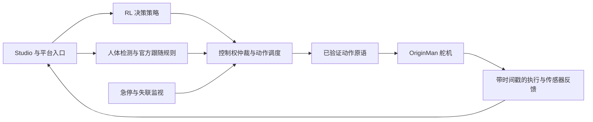

> 历史草稿：模型取得前的初始调查，已被 `docs/workshop-originman-x5.md` 和 `docs/originman-rl-validation.md` 替代。不得作为当前能力结论。

# OriginMan X5 Workshop：强化学习决策与人体跟随

方案日期：2026-10-29。状态：研发与课程设计稿，未完成 OriginMan 真机及整场验收。目标硬件是古月居／幻尔的 **OriginMan 人形机器人**，本文替代此前误按 OriginBot 差速小车编写的草稿。

## 1. 选型结论与课程范围

OriginMan 有官方动作组、视觉应用、人体跟随教程及基础 URDF 下载入口，适合继续评估 workshop。当前证据支持“已有应用与运动原语可用于接入”，尚不支持“我们的平台已能在它上面训练并部署双足步态”。

建议首版保留强化学习主线，但明确选择**高层动作决策强化学习**：训练策略决定何时前进一步、向左转、向右转或保持；稳定步态由事先验证的动作原语执行。最后切换到官方人体跟随应用，体验感知、决策、动作的完整链路。

若活动目标必须是“学员训练出新的关节步态并部署行走”，应走本文第 4 节的完整步态路线；其模型、反馈和底层运行时还存在前置缺口，不能直接承诺四小时现场完成。

| 课程路线 | 学员实际学到什么 | 现阶段定位 |
| --- | --- | --- |
| A：高层 RL 决策＋已有动作原语＋人体跟随 | 奖励设计、训练、评测、策略部署、视觉应用集成 | 建议首版；仍需开发 OriginMan 专用环境和运行链路 |
| B：关节级 RL 步态＋人体跟随 | 接触动力学、平衡、关节控制、Sim2Real | 扩展目标；基础 URDF 不足以证明具备可训练的物理和执行条件 |

这不是对 A 路线效果的现成承诺：若动作中断、重复执行或任务闭环验收不通过，课程也不能宣布可用。也不能把“已有动作组走起来”说成“RL 学会了走路”。

## 2. 官方资料核查：模型到底有没有

### 2.1 已确认与尚未确认

| 问题 | 本次查到的证据 | 严谨结论 |
| --- | --- | --- |
| 有没有机器人模型 | 官方开源资料页提供“Originman URDF文件”，明确注明“仅提供基础的模型文件” | **有官方模型下载入口**；本次未取得 URDF 文件内容，未检查 link、joint、mesh、惯性和碰撞体 |
| 有没有直接可训练的 MuJoCo／Isaac／Gazebo 工程 | 所查官方资料、应用仓库未提供充分可核实证据；所查仓库树未发现 URDF、xacro、STL、MJCF 或 USD 文件 | 暂不作为现成能力；不能从“提供仿真环境”的主页文字推断训练工程已完整交付 |
| 有没有现成 RL 步态 checkpoint | 本次检查未获得可核实的配套训练与真机部署证据 | 不承诺存在，也不作“全网没有”的判断 |
| 有没有关节操作能力 | SDK 有总线舵机位置写入、回读及停止接口；动作编辑教程有角度回读 | 有开发起点；关节回读带宽、实时性、单位和完整反馈仍待实测 |
| 有没有人体跟随 | 官方人体跟踪教程同时启动检测跟踪与速度转动作节点 | 有官方示例，但不是平台已贯通的 RL 跟随 |

来源：[开源资料页](https://originman.guyuehome.com/zh/material/open_source_link/)、[项目主页](https://originman.guyuehome.com/zh/)、[动作编辑教程](https://originman.guyuehome.com/zh/manual/action_editor/)、[人体跟踪教程](https://originman.guyuehome.com/zh/application/human_tracking/)。官方资料页中的 URDF 链接可供后续获取；网盘入口存在不等于本次已经检查了文件。

### 2.2 源码位置与资料之间的差异

官方网页的仓库链接并不完全一致。本次成功读取的是资料页指向的 [guyhome/originman_repo](https://gitee.com/guyhome/originman_repo)，包括递归文件树、速度转动作节点、SDK、动作组执行器以及一个 `.d6a` 文件。另一个 [GitHub 同名仓库](https://github.com/guyuehome/originman) 本次显示为空，不能用它代替实际源代码。

所查仓库有多个 `ros_robot_controller_sdk.py` 副本，文件摘要并不相同。实施时必须探测板端实际 import 路径和安装版本，再固定依赖；不能只改仓库内某一份就认为运行版本已更新。共享文档保留查询路径，具体源码版本和文件摘要放在当次验收附件。

### 2.3 模型获取后的必检项

拿到 URDF 后先做静态展开与资源检查，再导入选定仿真器：

1. 核实关节名称、轴向、零位、限位与实物舵机 ID 的对应；头、臂、腿及其他执行器分别列清，不从宣传自由度直接推导策略输出维度。
2. 核实单位、尺寸、质量、惯性正定性、质心、电池及 X5 外挂重量、足底接触和碰撞网格。仅能显示外观，不算动力学模型通过。
3. 补执行器模型：位置控制、动作插值、速度／力矩限制、延迟、死区、回差和饱和；确认训练器的理想 PD 与真实舵机执行方式是否匹配。
4. 核实 IMU 坐标、单位与时间戳，关节角／速度反馈，及观测获取时延；没有实测反馈的槽位不能用目标角度冒充。
5. 重置后无穿透、被动支撑稳定，先复现站立／受限动作基线，再进行训练。训练步态必须单独通过真机测试。

上述检查是拟定工程要求，本次未下载模型，因此不存在“模型已可用于 RL”的验收结论。

## 3. 源码检查发现的课程关键问题

以下针对本次所读源码，不能外推到供应方未来版本。源文件均可从 [官方资料页指向的仓库](https://gitee.com/guyhome/originman_repo) 定位。

### 3.1 `/cmd_vel` 在这里不是连续速度闭环

`originman_demo/originman_demo/cmdvel_to_action_node.py` 按阈值把消息分类为前进、后退、左转、右转等动作，且仅在动作类别变化时调用动作组；先判断线速度，再判断角速度。**不能拿差速小车的连续 `(v,w)` 策略直接接上，也不能把消息中的数值当作已测得的实际步速。**

这还意味着“连续两次前进一步”和“持续发布相同前进命令”不一定有同样语义。首版需显式的动作请求 ID、开始／完成／失败事件和重复动作测试。

### 3.2 零速会挥手，不能作为急停

同一节点把低于阈值的线／角速度映射为 `wave`。回调内同步执行动作，执行函数随后有固定等待；不能保证停止消息及时处理。其示例退出清理也不足以证明正在插值的舵机已经停止。

因此必须拆开“无运动意图”“任务完成问候”“软件停止”“紧急处置”。**零速停车语义必须先修正并验收，才能接平台统一控制。** 挥手只允许作为任务完成后的显式可选动作。

### 3.3 有 stop 函数，不代表停止时间有界

`driver/HiwonderSDK/hiwonder/ActionGroupControl.py` 逐行读取 SQLite `.d6a` 序列、发送舵机目标并等待；停止标志在序列检查点处理。SDK 另有舵机 stop 接口。需要验证已发送的动作插值、动作线程和新命令之间的交互，不能把函数返回当机械停稳。

本次仅以只读 SQLite 方式检查了一份单步动作文件，确认它是带时长和舵机位置列的序列；未执行该文件。它不是训练出的策略模型，也不证明对应步长／停止距离。

### 3.4 有角度回读，不代表能做高频全关节闭环

所查 SDK 的舵机回读路径使用锁和阻塞队列，未在该等待调用中设置超时。必须补超时、响应匹配及时间戳，实测整组关节刷新率与最坏延迟。源码中有 IMU 示例读取，不等价于已提供训练所需的高频姿态估计和全部关节速度。

## 4. 两条强化学习路线

### A：首版建议——学习动作原语的选择

课程任务拟定为“朝向视觉标记，短距离接近并在目标区停住”。先使用位置固定、身份明确的标记作为训练任务，人体跟随留在最后的独立应用环节，减少目标选择干扰。

**动作契约为新开发内容**，拟包括 `hold`、`forward_step`、`turn_left_step`、`turn_right_step`。每个动作须独立可重复、具有已验证的起止支撑状态，且完成后才允许下一次策略决策。不能仅以仓库里存在某个动作文件就认定它满足条件。

观测拟包括目标可见性、水平偏差、经过标定的目标距离或尺度区间、上一次动作、执行状态、IMU 倾斜与数据新鲜度。具体维度在实物采样后冻结。没有可靠距离估计时采用“近／远”任务，不宣传米级到点精度；不假定本体自带可用 `/odom`。

训练采用离散动作 PPO 或其他合适离散算法，**需要新建环境与策略头，当前 8→2 小车 PPO 不能直接复用**。平台可复用训练 Worker、Run、评测和制品框架。环境转移先由实测原语位移／转角／耗时分布构建，明确标注为经验任务仿真；按动作完成事件计步，统一可变时长动作的奖励、超时和折扣语义。该模型不证明双足接触稳定性。

首版主线：基线策略→修改奖励或原语误差随机化→短训练→固定场景评测→受控上板→回放。真机仅执行已经离线训练、评测通过的策略，不现场随机探索舵机。

### B：原目标的完整版本——学习关节步态

策略输出真实关节目标，须以 OriginMan 实物重新确定受控关节集合、观测与动作维度、默认姿态及控制周期。训练模型须包含相应身体与执行器动力学，不能套用 MicroDuck 权重或通过补零／截断硬凑维度。

平台已有 `board-joint-policy-runtime.py`，但当前实现对 MicroDuck 的 61D／14D 契约有明确校验，Profile 仍是 `template/mock`。可借鉴其新鲜度校验、限幅和文件协议，不能称为通用 OriginMan 关节运行时。改成另一台机器，需要同步修改训练、评测、板端、设备契约及测试。

开发前必须获得：可验证的机器人模型、关节映射和限位、带时戳的反馈、可测执行带宽、站立基线及中断／跌倒处置。学员现场最多做短训练或微调；完整步态基线要在课前训练并反复验证，不能承诺从随机权重开始四小时学会走路。

**A 路线可以保留真正的 RL 训练与部署体验，但不能据此宣布 B 路线已完成。若主办方坚持 RL 步态必须上真机，B 的前置门应作为开课条件。**

## 5. 四小时课程日程（A 路线）

课程题目建议：**用 AI 对话训练人形机器人的行动决策：从仿真评测到真人跟随**。

目标交互以 Studio 自然语言为主。下列指令是待实现和验收的课程交互，不代表当前插件已能全部执行。

| 时间 | 学员实操 | 可见结果 | 课前状态要求 |
| --- | --- | --- | --- |
| 00:00–00:20 | 烧录已准备的课程镜像；“连接本组 OriginMan 并检查环境” | 设备、应用和传感器清单 | 【复用】镜像和平台连接基础；【开发】专用镜像／Profile；【真机】恢复耗时 |
| 00:20–00:45 | “查看 IMU 和相机；验证单步动作、保持和停止” | 传感器变化、原语执行状态 | 【上游复用】动作与传感器接口；【开发＋真机】可重复原语和停止通道 |
| 00:45–01:10 | 查看模型资料与经验仿真；运行基线 | 明确动作选择与关节步态的区别 | 【开发】任务环境和可视化；模型未取得时不展示伪造官方模型 |
| 01:10–02:00 | 调整转向／动作切换惩罚，发起训练 | 真实训练 Run、奖励曲线、模型 | 【复用】训练基础设施；【开发】离散策略与课程配方；【验证】算力预算 |
| 02:00–02:15 | 休息与导师排障 | 查看训练状态、失败原因 | 不把 smoke 完成当质量达标 |
| 02:15–02:40 | 固定评测场景比较基线与训练策略 | 成功率、超时、耗时、原语数、稳定性事件 | 【复用】评测台账；【开发】任务指标和质量门 |
| 02:40–03:15 | 预检、部署，通过标记完成接近与停止，回放 | 模型指纹、原语事件、真机结果 | 【开发＋真机】OriginMan 专用运行时和闭环任务 |
| 03:15–03:45 | 停 RL 控制器，切换官方人体跟随 | 检测结果、动作状态；丢失目标后停止 | 【上游复用】跟随应用；【开发＋真机】仲裁、失联、停止与安全交接 |
| 03:45–04:00 | 分组展示和结果导出 | 一次真实训练、对比报告、真机视频／遥测 | 各组轮流进入测试区，结果来源明确 |

训练超时或未达门槛时，保留该组 Run 并分析原因，使用预先验收的基线模型完成真机环节；明确“这次上板是基线”。若原语或停止门未通过，真机环节不能按原日程发布，只能标为仿真课程与教师演示。

## 6. 最后的人体跟随如何保留

官方链路是检测跟踪产生速度消息，再由速度转动作节点调用预置动作组。首版将其封装为平台应用，支持 start/status/config/stop，并记录图像、目标、动作和异常事件。检测、规则控制和动作原语分别标注来源；不把它称为本次 RL 的训练结果。

需补开发：

- 导航 RL、跟随、手柄、动作编辑器和开机自启应用只有一个控制者；串口也须明确唯一 owner，避免多个 SDK 实例争读响应。
- 原示例的阻塞调用改为可观测、可取消的调度；拒绝过期命令，不把积压消息顺序执行为未来动作。
- 零速仅表示停止意图，问候单独触发；目标丢失／相机停帧／检测消息过期不能触发挥手或继续行走。
- 区分停止发新动作、停止当前插值、站立保持和断使能；具体机械处置依据当前支撑相位和实物测试确定。不能照搬小车的“发零速即安全”。
- 跟随阈值与实际步长、场地、摄像头视野匹配；不能保证单目框尺度对应精确距离，也不能把官方示例中的速度数字当实测速度。

## 7. 复用、补开发、待真机验证矩阵

【复用】指实现／资产存在，不表示已经在 OriginMan 上验收；【开发】指本课程需要新增或适配；【真机】指必须在实际套件和课程发行包内验证。

| 模块 | 已有基础／证据入口 | 状态 | 需要补齐的证据 |
| --- | --- | --- | --- |
| Studio／MCP 平台入口 | `services/duck-lab-mcp/`、`docs/duck-lab-mcp.md` | 复用＋开发＋集成验收 | 宿主设备绑定、鉴权、真实工具暴露、错误与取消提示 |
| 训练／评测／制品／部署台账 | `server/sim2real/`、`local-training-worker.mjs` | 复用＋适配 | 新任务与契约可跑真实训练，指标、模型指纹和部署记录贯通 |
| OriginMan 机器人描述 | 官方基础 URDF 网盘入口 | 待取得＋开发＋真机 | 文件内容、资源完整、关节映射、碰撞／惯性／执行器参数 |
| A 路线经验仿真和 RL | 现有 RL 引擎与任务包模式可借鉴 | 开发＋真机 | 离散动作环境、实测转移、奖励／时序、策略导出；无现成 OriginMan 训练成功证据 |
| B 路线步态训练 | MicroDuck 训练／评测接口及关节运行时 | 有限复用＋大量开发＋真机 | OriginMan 本体、执行器、观测和受控关节数全部重新核对；不复用鸭子权重 |
| 动作原语 | 上游 `driver/ActionGroups/`、`HiwonderSDK/hiwonder/ActionGroupControl.py` | 上游复用＋开发＋真机 | 起止姿态、可重复性、动作耗时、位移、转角和停止距离 |
| 关节与 IMU 反馈 | SDK 回读函数、官方 IMU 示例 | 上游复用＋开发＋真机 | 有界超时、单位、坐标系、源时间戳、带宽；必要时关节速度估计 |
| 人体跟随 | 官方教程和 `originman_demo/.../cmdvel_to_action_node.py` | 上游复用＋开发＋真机 | 修复零速／阻塞／重复动作语义，平台生命周期和单一控制出口 |
| 真机证据／回放 | 平台通用遥测与会话结构 | 复用＋开发＋真机 | 图像／IMU／动作请求／执行／策略制品关联；命令日志不冒充实际动作反馈 |
| BPU 视觉 | TROS 感知应用基础 | 上游复用＋真机 | 实际模型、输入、推理后端与显示链验证；RL 首版可使用 CPU ONNX，不强行承诺全部模型上 BPU |
| 课程镜像与多组现场 | 上游套件镜像、平台运维基础 | 复用＋开发＋整班验证 | 固定版本、离线依赖、设备隔离、算力排队、续航、备用机和四小时完成率 |

仓库本次检索没有 OriginMan 专用 adapter/profile；OriginBot 差速真机记录和 MicroDuck 模板均不能作为它的真机验收证据。

## 8. 开发顺序与准入门

| 阶段 | 工作内容／owner | 过门条件 |
| --- | --- | --- |
| G0：实物与源码核对 | 硬件与适配：官方镜像、实际 import 路径、舵机 ID、URDF 获取 | 资产清单与硬件身份一致，A/B 路线明确；A 不依赖未交付的动力学模型 |
| G1：原语与停止闭环 | 板端驱动／动作调度 | 无串口争用；重复动作、过期命令、执行完成、中断、传感器失联均可观察；零速不会挥手 |
| G2：RL 训练闭环 | 新引擎／任务包、评测、制品 | 固定对照、真实训练、ONNX 一致性、符合发布门槛；不能只改 `deployable` 标记放行 |
| G3：单车策略与跟随 | 板端运行时、应用管理、MCP | RL 策略上板与跟随切换分别通过，停止通道覆盖最终执行器 |
| G4：课程包 | Studio 集成、UI、运维与课程 | 新学员按文档完成；无设备、无算力、失败、空结果和取消有恢复路径 |
| G5：整班彩排 | 现场组织、训练服务、网络 | 按计划并发组数验证，保留全部失败与恢复耗时；单车成功不能替代 |

UI 实现按 `tokens.css` 和 UI 门禁执行；新增业务校验由平台服务端执行，并在 MCP 适配层同步。本文不修改实现或放宽现有门槛。

## 9. 拟定验收与课前准备

以下均为建议验收要求，**不是已有测试结果**：

- 原语：每种短动作在每台验收车上重复至少 10 次，报告完成率、耗时、偏航、姿态和异常。验证动作连续重复、前进转向切换，以及中途取消。
- 停止：覆盖动作刚开始、执行中、快结束、检测断流、网络断开及执行进程异常。实测停止延迟、剩余机械位移和支撑稳定性，再冻结课程可接受边界。未经测量不写固定毫秒承诺，也不默认断舵机电源安全。
- 任务：固定不少于 50 个仿真评测 episode，对比规则基线和 RL；随后至少 3 台同批次实物、每台 10 次任务。起始建议以每车至少 9/10 成功且无未受控动作作为课堂准入条件，精度、场地范围与时限须由原语标定结果确定。该小样本不代表生产可靠性。
- B 路线追加：完整关节反馈与执行时序、站立、起步、停止、转向及失稳处置逐项过门；仅 ONNX 推理成功不能算步态成功。
- 跟随：测试左右移动、靠近、离开、遮挡、多人入镜和重新出现；分别记录误选目标与失去目标后的动作。问候动作不作为停车证据。
- 全流程：由新手在课程发行包内完成一次，再按整班设备和训练并发量验证。训练时间、网络隔离、相机占用、续航及散热以实测为准。

按 2 人一组、一组一台 OriginMan 规划，先获得目标批次样机并完成 G0–G3，再确认批量数量。电脑提前装好 Studio；准备课程镜像和备用卡、读卡器、已缓存的依赖、训练算力和隔离测试区。小组动作测试由导师确认支撑与场地条件，现场不进行随机关节探索。

每组交付：一份训练配置、真实 Run、基线对比、模型指纹、真机任务视频／遥测，以及跟随应用配置。无法完成的项目直接注明原因；不以预录视频替代实操验收。

## 10. 相比原机器鸭 Workshop 的变化

保留 Studio 自然语言入口、云／电脑／板端协同、训练调参、评测、制品、部署回放与最后跟随。

首版调整为高层决策学习，底层动作利用上游原语；展示从鸭子步态／竞速变为人形机器人的接近目标、方向决策和真人互动。若要保留原计划的关节步态学习，就必须投入 B 路线的建模、训练和实时控制适配，工作量不能按“同为 X5，换个 Profile”估算。

对外可用的课程描述须绑定验收结果：A 通过后可称“训练人形机器人的行动决策并部署”；B 真机通过后才可称“训练并部署人形机器人的行走步态”。

## 11. 资料与本次验证范围

| 核对内容 | 官方来源 |
| --- | --- |
| 套件身份与配置 | [OriginMan 官网](https://originman.guyuehome.com/zh/) |
| URDF、系统镜像、源码和协议入口 | [开源资料](https://originman.guyuehome.com/zh/material/open_source_link/) |
| 速度转动作的人体跟随 | [人体跟踪教程](https://originman.guyuehome.com/zh/application/human_tracking/) |
| SDK／动作执行源码 | [资料页所指向的 Gitee 仓库](https://gitee.com/guyhome/originman_repo)，定位本文列出的文件 |
| 底板协议与传感器示例 | [通信协议](https://originman.guyuehome.com/zh/manual/protocol_description/)、[基础编程](https://originman.guyuehome.com/zh/application/basic_program/) |
| 角度回读与动作序列 | [动作编辑](https://originman.guyuehome.com/zh/manual/action_editor/) |
| 动作模仿的实际示例范围 | [模仿动作](https://originman.guyuehome.com/zh/application/imitate_action/)；不能仅据功能名认定已实现 BC／ACT 等训练 |
| 软件变更 | [更新日志](https://originman.guyuehome.com/zh/reference/changelog/)；以实际镜像和安装清单冻结版本 |

本次已阅读官方页面、应用仓库递归目录及上述关键 Python 源码，并以只读 SQLite 检查一个动作组；同时核对当前平台 Profile 与两类运行时。未取得 URDF 内容，未运行上游代码，未连接或驱动 OriginMan，未训练策略，也未完成 Studio 或整班验收。方案中所有现场指标均为拟定要求。
