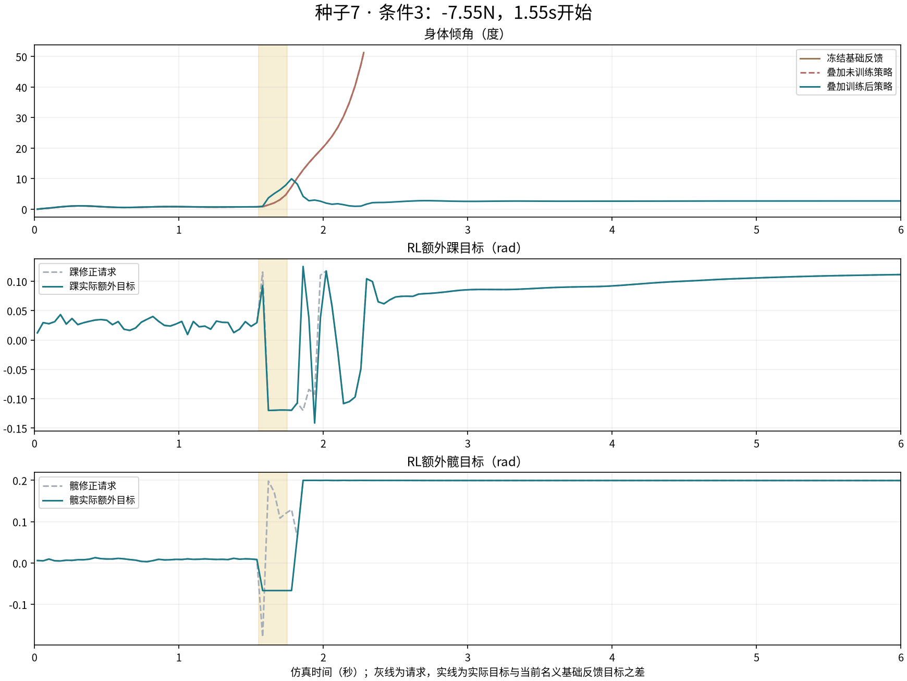
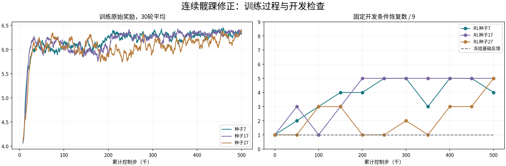
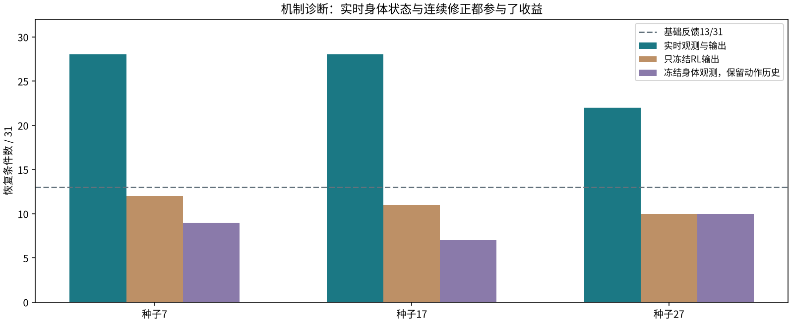
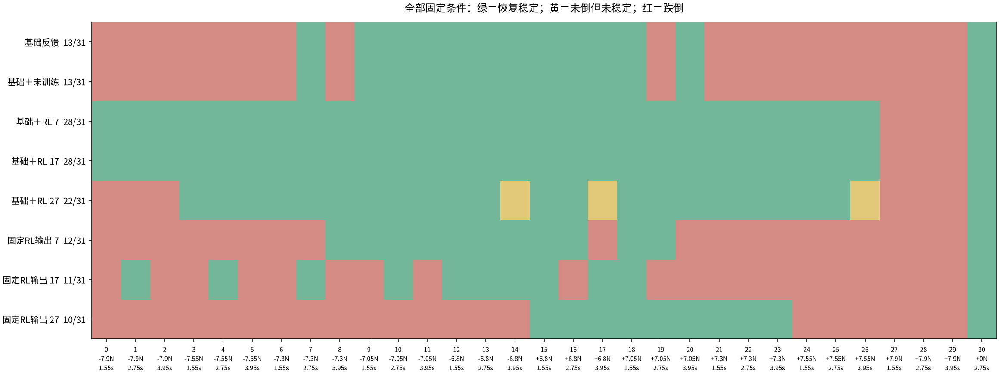
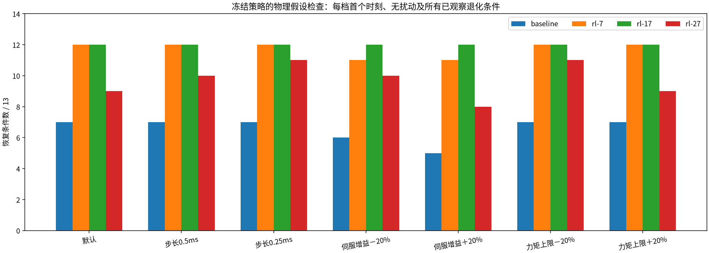

# OriginMan：稳定反馈加连续髋踝RL修正

本页保留原基础反馈的完整实验。已追加[合理传统反馈调参与同条件对照](originman-feedback-benchmark.md)：
新增条件中选定传统反馈17/31，RL三个种子26/31、26/31、20/31，种子27未达到原明显收益门槛。
课堂与宣发应同时引用这份后续结果，不把本页13→28当作完整的最终比较。

本轮在原地仿真中取得了明显的前后差异：固定基础反馈通过13/31个条件，叠加三个
独立训练种子的RL策略后，分别通过28/31、28/31、22/31。三个种子均保留无扰动
站立，并超过预先定义的净增加6个恢复条件门槛。种子27仍有两个退化条件。

这里的SAC策略每20ms读取本体状态、输出髋踝连续修正。基础反馈参数始终冻结，
不再由RL每回合选择固定Kp、Kd。原地恢复已得到仿真证据；迈步和真机迁移未完成。

## 直观看到的差异

同一初态，在1.55秒开始施加−7.55N侧向力，持续0.2秒：

|控制器|结果|倾斜角|
|---|---|---|
|无反馈参考站姿|2.12秒触发跌倒判据|约52.5°|
|固定基础反馈|2.28秒触发跌倒判据|约51.3°|
|基础反馈＋未训练策略|物理轨迹、关节目标与基础反馈完全相同|约51.3°|
|基础反馈＋训练后RL，种子7|恢复稳定，最终1秒全部满足检查|最大约10.0°，最终约2.7°|
|基础反馈＋训练后RL，种子17|恢复稳定|最大约8.5°，最终约0.75°|
|基础反馈＋训练后RL，种子27|恢复稳定|最大约6.2°，最终约0.77°|

这是11个共同改善条件中编号最小的一例。所有条件与失败保留，没有挑选中间权重
代替最终权重。跌倒后回合终止，视频保持实际终止姿态，不伪造完整落地过程。



## RL具体学什么

固定基础反馈为踝侧摆PD，Kp=2.5、Kd=0.225；髋部基础残差为零。这组参数来自
上一阶段的独立标定，本轮不更新。初始神经策略的均值输出为零，固定评测中它
与基础反馈的全部物理姿态和关节目标逐帧一致。

SAC通过物理交互学习一个14维状态到2维动作的神经网络：

- 状态包含侧倾角、俯仰角、相应角速度、左右髋踝位置和速度，以及上一步修正。
- 两个动作分别是额外踝侧摆与髋侧摆目标，映射到左右两腿的四个关节；不是四个
  关节完全独立的动作，也不是十关节完整步态。
- 修正请求幅度分别为0.12rad、0.20rad，再与固定反馈叠加，使用共同的关节总幅度、
  变化率和执行器限制。这些是仿真假设，不是实物允许值。
- 策略不读取扰动力、施力方向、施力时刻或世界位置；世界速度只参与奖励和评测。

奖励鼓励姿态、角速度和平面速度恢复稳定，并约束修正幅度与变化率。每次最终恢复
有明确奖励。模型和接触环境不因策略训练而改变，没有参考恢复动作或教师标签。

曲线的灰线记录神经策略请求，实线由实际关节目标和当前名义PD目标计算，表明
修正确实改变了下发位置目标。另保留去掉当前RL动作、使用同一先前命令时的单步
目标差，便于定位限幅和变化率限制。这些都是目标指令，实测关节响应另有记录。

## 三个独立训练种子

每个种子从零修正开始，训练500,224个控制步，使用4个仿真环境。只评测最终权重，
不依据开发检查挑选检查点。评测前已固定31个条件，覆盖正负五档推力、三个时刻
及无扰动站立。

|控制器|恢复条件数|跌倒条件数|相对基础反馈改善 / 退化|
|---|---|---|---|
|固定基础反馈|13/31|18/31|—|
|基础＋未训练策略|13/31|18/31|完全一致|
|基础＋RL，种子7|28/31|3/31|15 / 0|
|基础＋RL，种子17|28/31|3/31|15 / 0|
|基础＋RL，种子27|22/31|6/31|11 / 2|

种子27的两个退化条件为正负6.8N、3.95秒开始；它们没有达到恢复判据，不能隐藏。
这些数量是有限确定性仿真条件覆盖，不是真机随机成功概率。不同阶段的测试推力
和时刻不同，不能把上一阶段的19/31与本轮13/31直接当作同条件退化。



## 为什么可以把收益归给实时修正

增加了一项固定输出对照：只在扰动前计算一次神经策略输出，之后保持这个修正值，
基础PD仍持续闭环运行。它检验是否仅靠一个固定姿态偏移就能得到相同效果。

|种子|每20ms更新RL输出|固定在扰动前的RL输出|
|---|---|---|
|7|28/31|12/31|
|17|28/31|11/31|
|27|22/31|10/31|

实时策略明显超过固定输出。结合未训练策略与基础完全一致，可以将本轮改善归因
于训练后随状态变化的修正，而不能仅归给叠加网络、基础PD或固定姿态偏移。
这只证明超过当前冻结的基础反馈，不代表已经超过所有非RL髋踝控制方法。

补充冻结身体观测的诊断：将前12个IMU、关节状态保持在回合初值，但保留神经策略
自己的上一步动作输入，基础PD仍正常闭环。三个种子分别只恢复9、7、10个条件。
因此内部动作历史或固定摆动也不能解释完整策略的收益，实时身体状态参与了恢复。
该诊断不用于选取权重或重新调参。





恢复判据沿用上一阶段：6秒内不跌倒，并在最终1秒至少90%的控制步中同时满足
倾角不超过5°、角速度不超过0.3rad/s、平面速度不超过0.05m/s、高度不低于初始
85%、平面位移不超过12cm，以及两脚接触。未倒但持续晃动不计通过。

## 数值与物理假设检查

冻结全部策略，取每档推力的第一个时刻、无扰动，以及所有已观察退化条件，共13个。
没有重新训练或调参。

|假设配置|基础反馈|RL 7|RL 17|RL 27|
|---|---|---|---|---|
|默认，1ms物理步长|7/13|12/13|12/13|9/13|
|0.5ms物理步长|7/13|12/13|12/13|10/13|
|0.25ms物理步长|7/13|12/13|12/13|11/13|
|位置伺服增益−20%|6/13|11/13|12/13|10/13|
|位置伺服增益＋20%|5/13|11/13|12/13|8/13|
|假设力矩上限−20%|7/13|12/13|12/13|11/13|
|假设力矩上限＋20%|7/13|12/13|12/13|9/13|

这里改变的是模型的位置伺服增益，不是冻结控制器的Kp。所有检查均保留总体覆盖
收益，但只有13个条件；不能据此声称全部轨迹数值收敛或硬件参数范围已验证。



## 可视化、溯源与修改入口

本轮保留训练曲线、每5万步开发检查、每10万步检查点、初始和最终权重、模型与
源码快照、固定控制器配置、ONNX与输入约定、每个最终条件的物理轨迹，以及每20ms
的实际策略输入输出。视频另有固定0、10万、30万、最终步数的训练阶段对照。

|要修改或定位的内容|入口|
|---|---|
|固定反馈、14维观测、动作映射、修正幅度与奖励|`engines/originman-straight/residual_env.py`|
|SAC训练入口、固定熵系数和零初始修正|`residual_trial.py`；通用训练与导出在`standing_sac.py`|
|环境参数模板|`experiments/standing-residual.json`|
|同条件评测、固定输出对照、逐控制步决策记录|`residual_evaluate.py`|
|冻结策略的参数假设检查|`residual_sensitivity.py`|
|曲线、完整条件图与回放|`residual_report.py`、`residual_visualize.py`|

```bash
uv pip install --python .eval-venv/bin/python -r engines/originman-straight/requirements-sb3.txt
.eval-venv/bin/python engines/originman-straight/residual_trial.py \
  --scene <调用方适配的原始模型场景> \
  --experiment engines/originman-straight/experiments/standing-residual.json \
  --out <全新实验目录> --steps 500000 --seed 7
```

修改后创建新实验目录，不覆盖旧权重和评测。基础参数、输入编码和动作上限同时
写入制品；重放时检查它们与实现匹配。最终日志可用冻结ONNX从所记录输入重新
计算输出；输入中没有施力真值或施力时钟。

## 已完成与待完成

|类别|当前内容|
|---|---|
|已有并复用|原始模型适配、自由底座物理环境、实验记录、SAC依赖、ONNX导出和回放基础|
|本轮补开发|冻结反馈＋连续残差、14维观测、零初始策略、有效目标差、固定输出对照、逐控制步审计和三种子图文验证|
|厂家确认|模型对应整机、四个髋踝关节装配约定、IMU坐标与单位、位置目标覆盖和插值语义|
|待真机验证|带时间戳的关节回读及速度估计、IMU姿态与延迟、执行周期、执行器响应、足底接触、基础与RL同条件比较|
|尚未完成|迈步恢复、视觉跟随与RL步态集成及板端受控运行链|

本轮可作为有可见收益的原地连续控制RL仿真例子。它不替代基础版仍保留的步态RL
验收，也不替代最后人体跟随的独立联调。没有样机时，不将任何策略标为已可部署。
更完整的厂家与真机事项见[独立清单](originman-confirmation-and-hardware.md)。

现有工作台已加入本任务的配置、真实SAC训练、独立评测、曲线和四组物理回放，
不复用旧41→10适配器。页面重新训练后取得13/31到28/31的配对结果，操作见
[工作台纯仿真流程](originman-workbench.md)。
