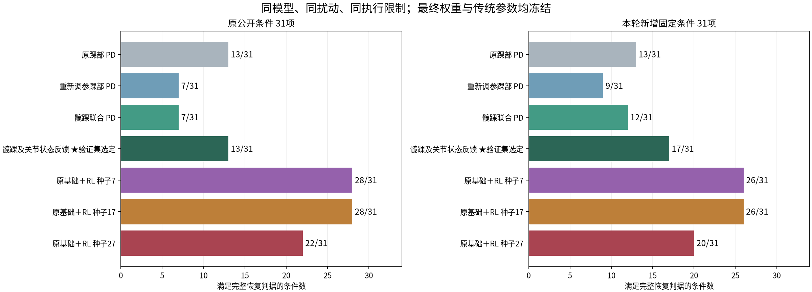
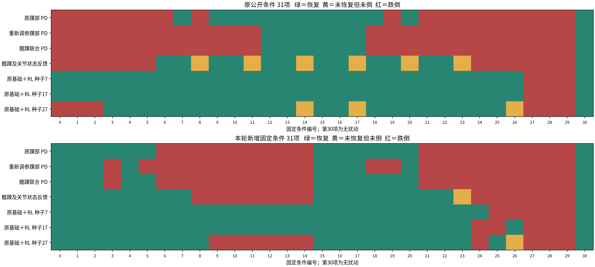
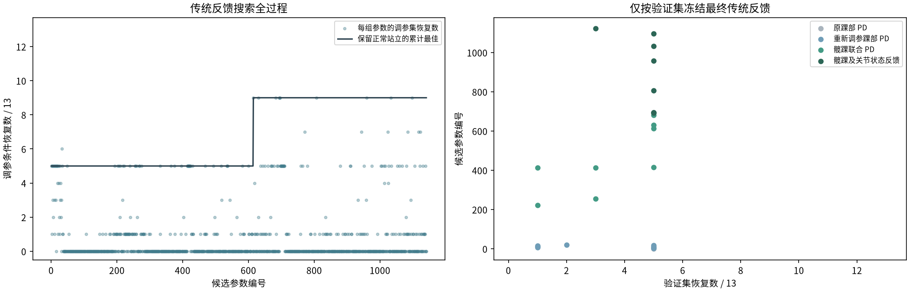
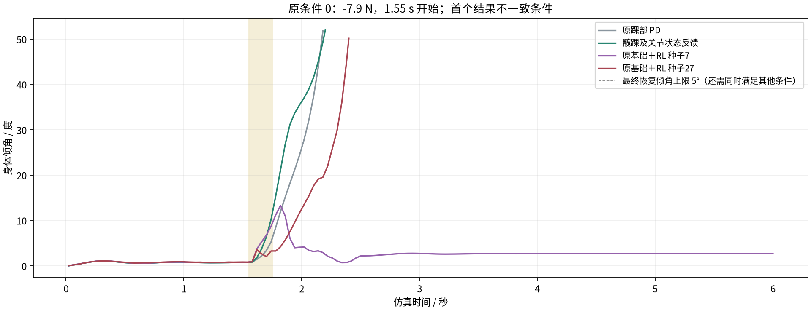

# OriginMan 传统反馈调参与冻结 RL 同条件对比

先调传统控制，再按验证集冻结参数，最后与原来的三个最终 RL 权重比较。本轮
没有重新训练 RL，也没有替换旧策略的基础反馈。双方的模型、参考站姿、初态、
扰动、动作限幅、变化率、伺服参数、力矩限制和恢复判据相同。

结论：RL 在本轮传统反馈候选上仍有覆盖收益，但新增条件中种子27只净增3项，
没有达到课程此前采用的“净增至少6项”明显覆盖收益门槛。不能承诺每个训练种子
都有同样明显的收益，也不能将结果解释为真机收益或 RL 不可替代。

## 完整结果

|控制器|原公开条件恢复 / 跌倒|新增条件恢复 / 跌倒|
|---|---|---|
|原踝部 PD|13 / 18|13 / 18|
|重新调参踝部 PD|7 / 24|9 / 22|
|髋踝联合 PD|7 / 24|12 / 19|
|髋踝及关节状态反馈，验证集选定|13 / 12|17 / 13|
|原基础＋RL，种子7|28 / 3|26 / 5|
|原基础＋RL，种子17|28 / 3|26 / 5|
|原基础＋RL，种子27|22 / 6|20 / 10|

每列均为31个固定条件。恢复与跌倒不是互补关系，未倒但持续晃动仍不通过。
所有控制器均保留无扰动站立。数量是确定性仿真覆盖，不是随机成功率。



选定传统反馈在原条件中，相比原踝部 PD 改善4项、退化4项，恢复总数相同；
跌倒从18项减少到12项，另6项未倒但未完整恢复。新增条件恢复从13项增加到17项，
改善4项、无退化。它并非逐条件更优，因此原控制器及各族结果全部保留。

三个 RL 种子相对选定反馈，在原条件净增15、15、9项，新增条件净增9、9、3项，
均无新增退化。相对原踝部 PD，种子27在原条件的两个既有退化仍保留。
四个非 RL 候选成功条件的并集为原条件17/31、新条件17/31；这个事后并集是
诊断上界，不是可部署的单个控制器。



## 传统反馈如何调参

第一轮进行413次候选参数评估：踝部 PD 网格、髋踝 PD 网格及 Sobol 搜索、局部
细化、关节位置速度反馈。第二轮在最终评测前追加728次差分进化评估：4维髋踝
PD 为40个体、6代，8维反馈为64个体、6代，不做末尾抛光。共1,141次评估，
重复参数保留，实际不同参数数量见交互报告。没有按最终结果重新调参或换权重。

- 调参集13项：正负6.6、7.2、7.8N，1.7与2.9秒开始，以及无扰动。
- 验证集13项：正负6.9、7.45、8.05N，2.1与3.5秒开始，以及无扰动。
- 每族最多8组独特调参候选进入验证，另保留原控制器；每轮25组验证分别留存。
- 选择优先级：保留无扰动站立、恢复数量、较少跌倒、最终稳定比例、较小峰值
  和最终倾角。第二轮搜索仍只使用调参集，最终评测尚未进行。
- 第二轮允许髋踝 P、D 增益为正负方向，范围分别±8、±1.2；关节位置反馈±2、
  速度反馈±0.5。范围均为仿真搜索设置。

调参集最佳9/13，最终验证集中各族均为5/13，按其余声明指标选出关节状态反馈。
调参收益没有完全转化到验证集，这是结果的限制。没有覆盖所有非线性控制、
增益调度、积分控制、LQR或MPC，不称传统控制已达到最优。



## 控制律与公平性

传统控制使用侧倾角、角速度，以及左右髋踝按模型轴方向换算后的平均位置偏移
和速度。与 RL 一样，不读取扰动力、施力时刻或世界位置。

```text
踝修正 = aP×侧倾角 + aD×侧倾角速度 + aq×踝偏移 + av×踝速度
髋修正 = hP×侧倾角 + hD×侧倾角速度 + hq×髋偏移 + hv×髋速度

aP=0.5101724084   aD=0.1181182026
hP=-1.4269238763  hD=0.0060798525
aq=-0.2372205119  av=-0.0831378613
hq=-1.0488153578  hv=-0.0243673142
```

角度为rad、速度为rad/s。传统反馈允许使用完整的±0.3rad共同修正幅度，每20ms
最多改变0.075rad，与 RL 合成目标共用相同执行约束。没有把传统髋部限制为零。
三个 RL 策略仍搭配训练时的原冻结基础 PD，没有直接换成新反馈。

## 最终评测与可视化

原公开31项为历史基准。新增31项侧推为正负6.55、6.95、7.4、7.75、8.0N，开始
时刻1.83、2.47、3.37秒，另含无扰动。推力持续0.2秒，回合6秒。新增条件未参与
本轮传统参数搜索和选择；整个任务已有历史开发，不称整个研究为盲测。

恢复仍要求全程未跌倒，最后1秒至少90%的控制步同时满足倾角≤5°、角速度
≤0.3rad/s、平面速度≤0.05m/s、高度≥初始85%、平面位移≤12cm和双脚接触。

共完成62条件×7控制器＝434回合，保留完整压缩轨迹。回放选择原条件中选定
反馈与 RL 种子7结果首次不同的编号0，不按最大视觉差异选例；同时展示原反馈、
新反馈、RL种子7及较弱的种子27，后者在本例跌倒。跌倒后保持实际终止姿态。
交互报告可切换全部条件和任意两个控制器，不将单段视频代表整体。



## 对 Workshop 的影响

可以保留原地恢复教学案例，但必须同时介绍调参后的传统反馈和 RL 种子差异。
讲师已验收权重与学员现场训练分别标注；完成训练流程不自动计为明显收益。
现有工作台常规评测仍使用原冻结踝部 PD，本轮是独立补充报告，没有修改训练
契约。若把新反馈纳入学员训练主线，须新建实验重新训练和验收。

## 复现与证据

- 调参及评测：`engines/originman-straight/feedback_benchmark.py`。
- 图表和交互报告：`scripts/report-originman-feedback.py`。
- 独立实验根目录：`artifacts/originman-feedback-benchmark-01/`。
- 第一轮：`tuning/`；细化和冻结参数：`tuning-refined/`。
- 完成的评测：`evaluation-02/`，完整轨迹为`episodes.jsonl.gz`。
- 图表、视频、可离线打开的报告：`report/index.html`；检查摘要：`acceptance.json`。

相关15项测试通过。历史31项中，原控制器与三个 RL 策略的物理姿态及关节目标
与既有记录逐帧精确一致，每种子核对62条、共186条。模型和源码运行前后校验
一致，三个 RL 制品校验通过。

首次评测因磁盘空间不足中止；部分轨迹无损压缩保留在`evaluation/`并标为未完成，
未用于选参。随后仅将完整轨迹存储改为gzip，条件和参数不变，全部重跑至完成。
未删除控制器失败案例或原有实验。

真机仍需型号对应、关节约定、位置执行语义，以及执行器响应、IMU延迟、控制
周期和脚底接触实测。本轮不产生硬件部署资格。
