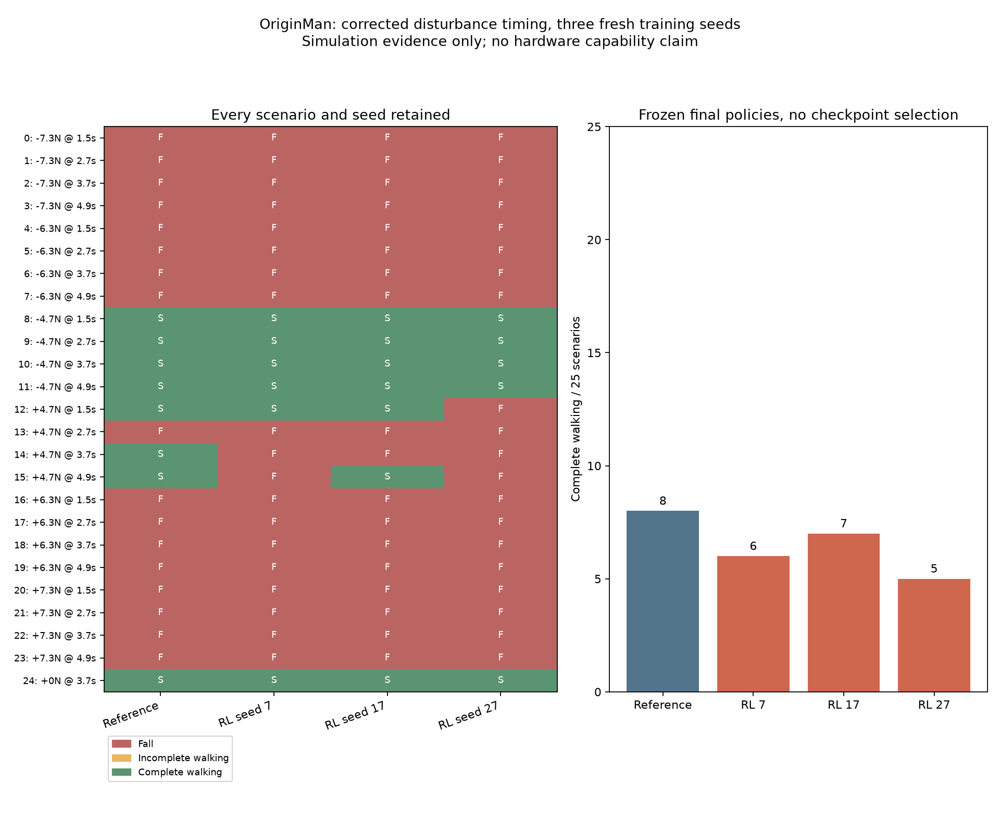
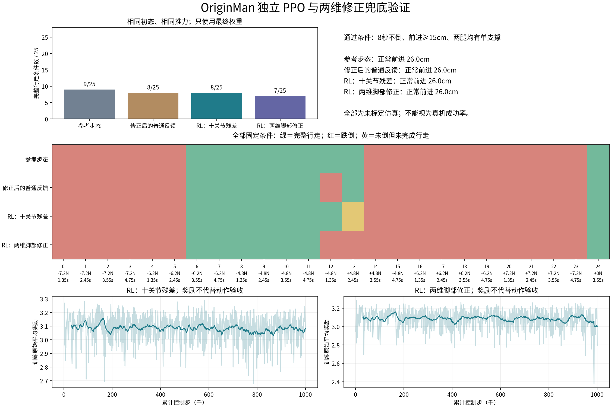

# OriginMan 强化学习能力验证

目标是找出视觉上有明显收益、能通过真机验证的强化学习动作。原地连续髋踝修正
已取得仿真证据；步态和真机目标尚未完成。用户已确认暂无样机，离线结果不替代
实际落地证据。

原基础反馈实验：冻结基础反馈通过13/31个固定条件；每20ms输出额外髋踝修正的三个SAC
种子分别通过28/31、28/31、22/31。三个种子保留无扰动站立，具有11个共同改善
条件，种子27有两个退化条件。固定策略输出或冻结身体观测后收益明显下降。
完整前后回放、消融、数值与执行器假设检查见[连续修正图文验证](originman-continuous-residual.md)。

最新合理反馈对照已完成：1,141次参数评估后，选定传统反馈在新增条件恢复17/31，
原三个RL种子分别26/31、26/31、20/31。种子27净增3项，未达原“明显收益”门槛。
这不代表所有传统控制的上限，也不保证每次训练改善。见[完整反馈对照](originman-feedback-benchmark.md)。

此前的[PPO反馈参数学习](originman-standing-recovery.md)作为历史阶段保留；它与当前
逐控制周期的神经修正策略不同。下文的早期失败实验不代表最新原地连续控制结论。

## 已获得的证据

|候选或检查|已验证内容|当前判断|
|---|---|---|
|直行纠偏|多种子 PPO 和同条件参考步态比较；部分结果降低横向偏差，同时降低前进距离|尚无稳定、明显且不牺牲前进的收益|
|定点变力度踢球|三个 PPO 种子、非 RL 标定插值、冻结权重测试|没有稳定、明显超过简单标定方法|
|踢球模型敏感性|204 个单因素回合、72 个步长回合|毫米级方法差距小于数值步长变化，不能据此排序|
|脚底模型修订|原始碰撞 STL 凸包替换脚底包围盒；质量惯量和语义 IK 坐标保持一致|更贴近原始几何，仍未实物标定；不能等同精确数字孪生|
|脚底对照|两种模型、四个步长、8 个正常迈步回合及96个冻结踢法回合|正常迈步约26–27cm/8秒且未跌倒；横向轨迹仍有变化，冻结踢法的稳定性随模型变化|
|受扰行走首轮|300轮 PPO；13个固定测试条件；64组 IMU反馈参数、512个调参回合|参考与调参反馈各6/13成功；首轮RL为0/13，不作为成功演示|

所有成功率均指有限、确定性的仿真条件覆盖，不能作为独立随机真机成功率。

## 正在验证的候选：受扰后恢复并继续走

参考关节轨迹提供基础迈步，RL每20ms输出10个腿部关节残差，根据姿态、角速度、关节状态及步态相位修正动作。侧向扰动只施加在躯干质心，持续0.2秒，不注入前进力，不把扰动力直接提供给策略。

候选动作的可见收益必须是受扰后恢复并继续迈步，不能以站住、停止前进或缓慢挪动代替。第一轮已出现这种指标不满足的情况，结果保留。

第二轮调整依据：首轮较大策略更新幅度和值函数误差；逐帧速度奖励可能惩罚正常步态的周期波动。第二轮启用奖励缩放、KL更新限制，以及仅用于奖励的因果速度平滑。它们不改变物理推力和最终动作成功标准，不向策略增加真实世界无法获得的速度真值。

训练与评测入口：

- `engines/originman-straight/train.py`：训练、源码与模型快照、日志、检查点、ONNX一致性。
- `engines/originman-straight/push_eval.py`：预先声明扰动条件、调参 IMU 反馈基线、冻结最终权重比较。
- `engines/originman-straight/render_push.py`：重放第一个固定测试条件，失败后停在最后记录姿态，不挑选最好视频。
- `engines/originman-straight/contact_probe.py`：原始网格与包围盒、不同物理步长的对照。

## 候选采用条件

1. 完整8秒不跌倒，前进至少15cm，左右腿各出现至少5帧单支撑；距离来自物理状态。
2. 在预先声明的条件下，相比参考步态和调参反馈有清楚、可重复的收益；保留全部种子和失败条件，不能只挑一段视频。
3. 正常无扰行走不能明显退化；减小步长、改变接触和执行器参数后，收益不能只剩在一个精确参数点。
4. 真机完成关节映射、时序、执行器响应、传感状态和同条件对照，才能称为实际落地。

目前第2至4项没有完成。即使单个仿真种子成功，也继续保留目标未完成状态。

## 真机与厂家事项

见[独立清单](originman-confirmation-and-hardware.md)。没有样机时仍可开发和测试模型、训练与运行时软件，但无法证明实物接触、真实执行器响应和动作收益。

不要求厂家替我们交付RL能力。厂家需确认模型对应的整机配置、装配坐标和固件控制语义；控制时序、舵机负载响应和迁移效果可在获得样机后共同测量。

第二轮最终条件另行预先固定为25个场景，使用新的扰动力和施加时刻；原13个场景
降为开发/回归检查。最终权重完成后只评测一次，不按测试结果选检查点。
新的物理参数迁移检查使用冻结控制器，不在迁移场景重新调参。

## 第二轮已完成的结果

600轮训练结束后，固定最终权重完成25个新条件的配对测试：参考步态和有限调参
IMU反馈各10/25成功、15/25跌倒；RL为0/25成功、8/25跌倒。无扰动前进距离
参考约26cm，RL约9cm。跌倒减少伴随明显的行走退化，不能认定为抗扰收益。

另完成九个假设物理配置、每配置13个开发/回归条件，共351个控制器回合；RL均
未满足完整行走成功标准。两个训练试验源码均未在运行期间变更，ONNX数值一致性
通过；这些只证明实验完整性与推理一致性，不证明动作效果或真机可靠性。

当前决定：不采用这两轮受扰行走策略作为workshop成果，不进入真机部署。
下一项是诊断训练为何破坏基础步态，先建立无扰动行走保留门槛，再验证扰动恢复。
更改奖励后仍使用相同物理成功标准，不以奖励分数代替行走。没有证据说明机器人
本身不能做到；也没有证据支持目前承诺能做到。

## 接管式残差试验

诊断确认：在原共享特征网络中，单独优化值函数也会改变动作输出。独立值函数
通过了不改变动作输出的检查；这只证实一种漂移机制，不证明它解释全部失败。
接管逻辑只使用姿态与角速度，不读取推力，不提供恢复轨迹。正常时保持参考步态，
失稳时开放RL残差；未执行的策略动作不参与策略梯度更新。

500轮训练的最终25个新条件中，参考和RL各9/25成功。无扰动时，两者均前进约26cm。
存在一处参考失败、RL成功，也存在一处参考成功、RL失败，总体收益尚未成立。
原始条件编号14为4.75N侧向扰动、3.5秒开始；RL最终前进约21cm，参考跌倒。
编号19为反向结论，必须与改善例子一起保留。力值仍只是仿真设定。

因此目前证明了一个可见的仿真恢复例子，未证明稳定可采用的能力，更未证明真机落地。
下一试验增加临界扰动与不同步态时刻的训练覆盖，保留相同的完整行走判据，并预先
另行固定最终条件。源码、模型、训练来源、逐回合记录、改善和退化视频分别保留。

## 修正时序后的最终三种子复核

已修复推力计时：改用物理子步施加，记录每个控制周期的冲量、平均力与实际
作用窗口；接管保持时间使用控制步计数。修复前构造的三个时序反例现通过。
当前OriginMan引擎30项检查通过；隔离Local Worker实际训练、进度解析与制品
清单校验通过，仍明确标记deployable=false。

修正环境下，三个新随机种子均从头训练500轮，固定同一参数配置和25个新条件，
只评测最终权重。参考为8/25成功；RL种子7、17、27分别6/25、7/25、5/25。
预先限定绝对力值不超过6.3N的17个条件里，参考8/17，RL分别6/17、7/17、5/17。
所有种子无扰动前进距离均保留100%；但这来自参考步态与接管逻辑，不能单独
算作RL收益。每份训练完整性和评测源码、模型未变更检查均通过。

此前的临界扰动1000轮微调也已完成：旧时序25个条件里参考9次、RL10次成功，
修正时序后同一权重与条件为10次对10次；其他物理参数和控制周期下仍未体现
稳定优势。早期单次恢复例子在修正环境里仍发生，不能扩称为总体能力。

当前结论是不把该策略作为已验证的workshop核心成果。它不证明OriginMan在
物理上不能做RL，也不证明其他算法或动作都失败。样机及模型适用性、关节约定、
IMU坐标和固件语义需要确认；实际时序、执行器响应和足底接触需要测量，才能
据实修订模型与决定动作。没有这些证据不能确认实际落地。

较早草稿已归档，现行课程文档为[完整 基础 简略三档方案](workshop-originman-x5.md)。
后续不将继续优化未标定仿真参数当作已接近实物交付的证据。

## 独立 PPO 与两维修正兜底复核

本轮发现并纠正了我们普通反馈对照中的关节符号问题：左右髋侧摆轴分别为
负X与正X，旧反馈却使用相同的原始关节符号。参考轨迹使用运动学求解，不受
这处问题影响；旧反馈的零增益结果不能作为成熟反馈控制的上限。历史记录保留，
本轮重新按物理轴方向调参。这里比较的仍只是有限参数的PD反馈，不能代表所有传统控制。

更换为独立的 Stable Baselines3 PPO 实现，分别训练十关节残差和两维脚部修正。
后者通过原模型的雅可比将横向移脚、脚底侧倾转换为10个关节残差，不修改物理
环境、正常参考步态或成功判据。每版训练1,000,448个控制步，均为种子7。
策略使用4帧本体观测和冻结的归一化参数，不读取扰动力或世界位置。

独立训练器先在CartPole固定20个测试种子中完成健康检查：随机动作平均20.5分，
PPO平均487分。这仅验证该依赖和训练管线能学习简单任务，不证明机器人任务可解。

普通反馈重新搜索144组参数、1,152个调参回合，冻结后与两版RL比较预先固定的
25个新条件。训练、调参与最终条件分开；不从检查点中挑选最终结果。

|控制器|完整行走条件|跌倒条件|无扰动前进|
|---|---|---|---|
|参考步态|9/25|16/25|约26cm|
|修正并调参的普通反馈|8/25|17/25|约26cm|
|独立PPO，十关节残差|8/25|16/25|约26cm|
|独立PPO，两维脚部修正|7/25|18/25|约26cm|

两版RL均没有新增参考失败而RL完整行走成功的条件；十关节版退化1个条件，两维版
退化2个条件。正常行走保留仍来自参考步态和接管逻辑，不计为学习收益。
这次没有获得明显的抗扰行走能力；也不能据此断言OriginMan无法学习步态。

两版训练期间的既有源码未变更，ONNX最大绝对误差分别约1.79e-7、2.38e-7；
历史帧与归一化预处理已与实际训练包装器逐步核对。额外的训练后完整性清单覆盖
权重、归一化参数、参考轨迹、脚部转换表、模型及日志。这些是复现证据，不是动作质量证据。

复现入口是 `sb3_trial.py`、`tune_axis_feedback.py`、`sb3_evaluate.py`、
`sb3_receipt.py` 和 `sb3_report.py`，均位于 `engines/originman-straight/`。
独立实现需安装 `requirements-sb3.txt`；尚未接入工作台训练选项和硬件运行时。

### 兜底选择与边界

|路线|目前依据|下一步与限制|
|---|---|---|
|保留步态RL目标，先验证原地受扰恢复|本轮行走任务尚未取得优势；固定站姿可减少步态相位变化|尚未训练验证。必须先证明同样扰动下参考倒、RL恢复，再逐步加入迈步；大脚本身站得住不能算收益|
|将变力度踢球作为额外仿真教学展示|此前60个固定条件，固定踢法平均距离误差4.67cm；三个RL种子约1.77–1.99cm|简单标定插值约1.93cm，RL没有稳定优势。它学习每次踢球的轨迹参数，不能替代连续步态RL；模型数值与真机接触仍待验证|
|保住整场活动的应用展示|参考运动和官方人体跟随有独立工程起点|可以单独准备并验收，但不算完成用户要求的RL步态成果；实物仍需彩排|

当前建议将原地受扰恢复作为下一项有限实验，保留“无扰稳定不算RL收益”的门槛。
若它也无法形成可重复差异，基础版的步态RL成果仍未达到开课条件；增加训练轮数、
切换动作组或剪辑成功片段均不能代替验收。厂家与真机待办继续使用独立清单。
