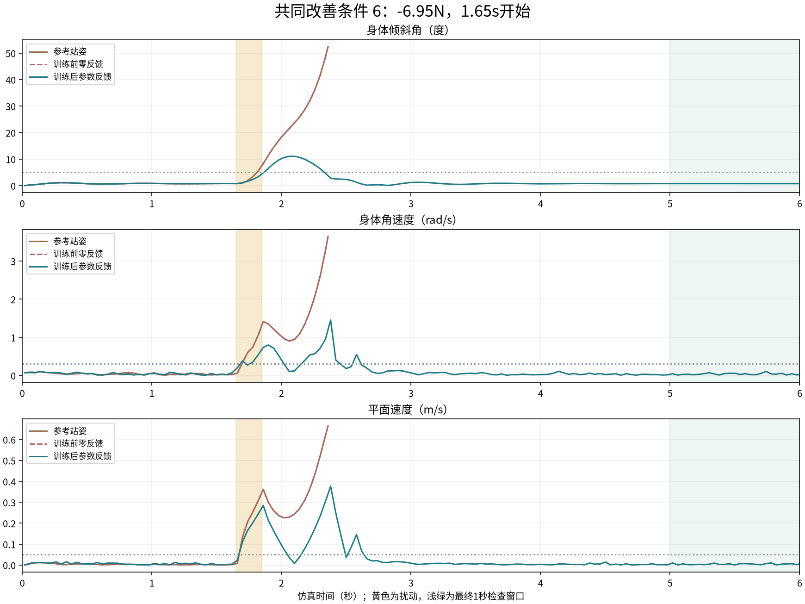
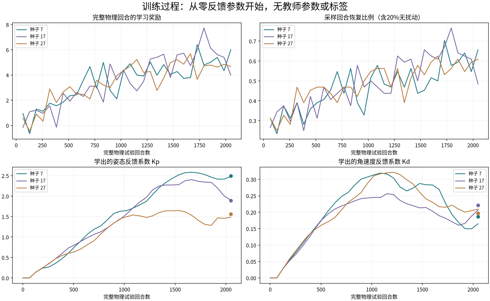
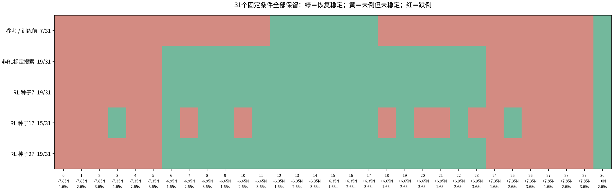
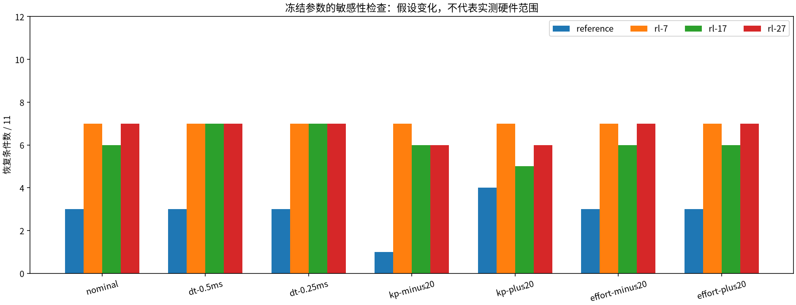

# OriginMan 原地受扰恢复：仿真验证

本文保留反馈参数学习阶段。后续的[连续髋踝RL修正](originman-continuous-residual.md)
已取得逐控制周期神经策略的可见仿真收益，当前结果请先看该记录。

本阶段做出了“同样扰动下，参考站姿触发跌倒，RL学出的反馈恢复稳定”的仿真原型。
有效结果来自**反馈参数学习型RL**：PPO通过完整物理回合的奖励学习两个控制系数，
运行时由PD连续控制踝关节。当时逐时刻神经关节策略、受扰迈步和真机迁移尚未通过。

## 前后差异

同一初态，在1.65秒开始施加−6.95N侧向力，持续0.2秒：

|控制器|结果|倾斜角|
|---|---|---|
|参考站姿|2.36秒触发跌倒判据，回合终止|约52.4°|
|训练前，反馈参数均为零|与参考记录完全相同|约52.4°|
|训练后，种子7|6秒结束时恢复稳定；最终1秒全部满足检查|最大约11.1°，最终约0.74°|

该条件在三个独立训练种子中都出现改善。它是六个共同改善条件中编号最小的一例，
没有按视频效果挑选。跌倒回放保持实际终止姿态，不伪造继续站立或倒地轨迹。



视频采用原始网格与记录的物理姿态。四画面对照包含参考、非RL标定反馈、训练前和
训练后。另保留更强扰动的失败视频，以及固定512、1024回合检查点和最终参数的训练
阶段回放。本地产物由文末入口生成，不随代码分发厂家模型。

## RL学了什么

每次物理试验开始时，PPO选择姿态反馈系数Kp和角速度反馈系数Kd。PPO的输入只是
固定任务标记，不读取推力大小、方向、时刻或世界位置。参数从零开始，没有教师参数
和动作标签；试验完成后的跌倒、稳定比例、倾角及角速度形成学习奖励。

运行时每20ms读取侧倾角和相应角速度，将 `Kp × 侧倾角 + Kd × 角速度` 转换成两个
踝侧摆关节的位置残差。原模型的关节轴决定左右命令符号；使用共同的幅度、变化率和
执行器限制。其他关节保持参考站姿，髋部残差为零。

|训练种子|Kp|Kd|完整物理试验回合|
|---|---|---|---|
|7|2.4923|0.1861|2048|
|17|1.8915|0.2214|2048|
|27|1.5601|0.1971|2048|

这是单步任务的参数策略，执行器端是连续反馈。不能描述成神经网络每20ms自主协调
全部腿部关节，也不能描述成已经学会走路。



曲线中的恢复比例来自带探索噪声的训练回合，包含20%无扰动条件。它不是最终测试
成功概率。参数曲线记录批次更新前状态，末端圆点是最终更新后的实际参数。

## 全部固定条件

最终条件在训练前固定，覆盖正负五档推力、三个时刻及一个无扰动条件，共31个。
只评测最终参数，不按测试结果选择检查点。

|控制器|恢复条件数|跌倒条件数|
|---|---|---|
|参考与训练前|7/31|24/31|
|RL，种子7|19/31|12/31|
|RL，种子17|15/31|16/31|
|RL，种子27|19/31|12/31|
|非RL标定搜索|19/31|12/31|

三个RL种子有六个共同改善条件，没有将参考已通过的条件变为不通过；无扰动站立
均保留。种子17仍有更明显的条件依赖，不能将最好种子的覆盖范围推广到全部策略。



非RL标定搜索使用相同的两个参数范围和训练推力，共2000个物理回合，并优先要求
无扰动站立通过。它在冻结测试中也达到19/31。因此本实验证明RL能从奖励学到有效
反馈参数，没有证明RL优于充分标定的反馈控制。

较早的普通反馈按更强开发扰动选择，在最终无扰动检查中未达稳定比例门槛，不能
作为成熟控制的上限。原记录保留；本表使用补充的匹配预算标定结果，不用较弱基线
夸大收益。

## 恢复判据与仿真边界

回合长6秒。恢复必须同时满足不跌倒，并在最终1秒至少90%的控制步中满足：

- 身体倾角不超过5°，身体角速度不超过0.3rad/s。
- 平面速度不超过0.05m/s，基座高度不低于初始高度85%。
- 平面位移不超过12cm，两脚均接触地面。

这些判据用于防止把持续晃动、低姿态撑住或一直滑动计为恢复。参考跌倒后按环境
判据终止，视频不是完整落地碰撞过程。

冻结控制器后，按每档推力取第一个时刻，再加无扰动，共11个条件，检查物理步长
和执行器假设的单因素变化。所有配置下，三个RL种子均保留相对参考的覆盖收益。
1ms、0.5ms、0.25ms下，参考均通过3/11；三个RL种子分别为7/6/7、7/7/7、7/7/7。



此处还改变了假设的位置伺服增益和力矩上限，但没有真机测量范围。只有11个条件
接受该检查，不能当作全部条件收敛、随机硬件成功率或数字孪生已经准确的证明。
摩擦、真实舵机延迟、死区、供电和IMU估计误差仍待验证。

## 未成功的路线也保留

|路线|最终恢复条件|结论|
|---|---|---|
|接管式PPO，4帧41维本体状态，约100万控制步|参考1/31，RL1/31|部分减少跌倒，没有恢复稳定|
|持续反馈PPO，相同输入，约100万控制步|参考1/31，RL0/31|无扰动稳定也退化|
|SAC，单帧41维状态，约25万控制步|参考5/31，RL0/31|减少部分跌倒，未恢复稳定|
|SAC，仅侧倾角和角速度，四个零初始权重，三个种子各约25万控制步|参考7/31，RL分别1、4、1/31|没有出现参考跌倒而RL恢复的改善条件|
|PPO，完整回合学习两个踝反馈参数|参考7/31，RL分别19、15、19/31|获得本阶段的可见仿真收益|

除三个最小SAC种子共用相同条件外，不同路线分别使用新的固定测试条件，不能直接
据表中数量排名算法。参数策略也改变了学习时序、奖励和控制假设，不能将改善仅
归因于PPO优于SAC。这些结果不证明逐时刻RL或OriginMan步态在物理上不可行。

## 复现、定位和修改

代码入口均位于 `engines/originman-straight/`：

|内容|入口|
|自由机器人、扰动时序与执行器限制|`env.py`、`model.py`|
|原地站姿、恢复判据和连续反馈|`standing_env.py`|
|参数PPO、参数范围、训练扰动和回合奖励|`standing_gain_rl.py`|
|匹配预算非RL标定|`standing_gain_baseline.py`|
|冻结参数的假设变化检查|`standing_sensitivity.py`|
|四画面物理轨迹回放和报告|`standing_render.py`、`standing_report.py`|
|环境配置模板|`experiments/standing-recovery.json`|

```bash
uv pip install --python .eval-venv/bin/python -r engines/originman-straight/requirements-sb3.txt
.eval-venv/bin/python engines/originman-straight/standing_gain_rl.py train \
  --scene <调用方适配的原始模型场景> \
  --experiment engines/originman-straight/experiments/standing-recovery.json \
  --out <全新实验目录> --episodes 2048 --seed 7
```

物理环境参数通过JSON修改。参数范围、训练推力、学习率与回合奖励目前在训练脚本
中明确声明，修改后创建新实验，不覆盖原产物。训练保留模型和源码快照、实验配置、
逐回合结果、参数曲线、采样轨迹、检查点、初始权重、最终权重及导出的控制系数。
最终参数已核对为实际PPO输出，训练前确为零参数。

本次回放补齐实际终止时刻和姿态，按记录时间戳重采样视频；两个固定条件的补充
回放中，动作指标与原评测完全一致。调用方资产门禁49项检查通过，包含实际PPO
输出与终止轨迹核对。训练、评测和回放分别保留来源摘要。现有平台的模型适配、
记录结构和训练依赖得到复用；此实验尚未加入工作台选项和板端受控运行链。

厂家确认和真机验证继续使用[独立清单](originman-confirmation-and-hardware.md)。
下一阶段才是把冻结的反馈接入迈步，重新检查正常步态与同条件抗扰收益。当前结果
不替代基础版所保留的步态RL验收，也不替代最后人体跟随的独立联调。
