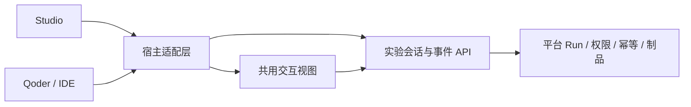

# 插件、IDE 与平台的统一体验

目标：学员只说“带我完成 OriginMan Workshop”，即可看到准备、训练、评测和回放。
在 Studio 或 Qoder 继续同一个明确实验时，恢复相同任务，不重复提交，不借用别组结果。
本文件是改造方案；未实现的服务端实验会话、事件订阅和内联界面不能算作已有功能。

## 已有能力与本分支改动

- 插件通过 MCP 复用平台权限与 Run 状态；宿主拥有自己的模型通道和页面打开能力。
- 本机实验引用按平台、当前账号与实验标识隔离；它不是跨机器同步服务。
- 精简状态缺少评测父任务时，补读相同 Run 的 lineage，核对 ID、模型、状态和父任务，
  再保存引用。来源冲突拒绝保存；完成后仍核对策略摘要，不因补引用而重新训练。
- 默认简短中文，按“当前进度、结果、下一步”组织，正常校验不逐项播报。
  仅阶段变化、阻断、选择和完成时提示；诊断明细按需展开。
- 导出包增加 `.qoder-plugin/plugin.json`，与 Studio 使用相同插件名、版本、技能和 MCP
  声明；使用 Qoder 支持的字段，不依赖目录名称隐式生成身份。
- 指南明确本版没有 MCP Apps 内联资源。优先使用宿主工作台，其次浏览器链接，最后短文字。
  这只是输出约定，不能代替宿主真实打开和播放验收。

## 需要统一的四层



平台继续拥有训练、评测和部署事实；插件负责把用户意图变成可追溯流程。
宿主适配层只处理登录衔接、打开页面、交互能力和连接生命周期，不再各自维护课程逻辑。

### 1. 统一安装与诊断

安装记录、当前启动入口、进程加载摘要和平台 API 能力分别核对。任一版本不一致时给出
一个明确的修复入口，不允许用安装列表版本证明运行版本。
插件更新只替换同一插件身份，旧包放到扫描目录之外；不增加同类重复连接。

诊断分层显示：宿主模型通道 → MCP 进程 → 认证 → 平台 → 资源 → 当前实验。
宿主模型尚未就绪时，不提示“重新安装学习插件”或“重新登录学习平台”。
网络故障保留登录状态，不自动重新授权、不无限重试写入。

### 2. 平台保存实验会话

拟增加版本化实验 API，保存明确训练与评测引用、阶段、参数快照、策略摘要和事件游标。
本机文件只作离线缓存及旧平台兼容；新客户端可在同平台、同账号下通过明确实验标识恢复。
接口尚未实现，不能先在客户端生成看似有效的服务端会话链接。

读取和写入均重验当前账号权限；实验 ID 不是访问凭据，不在链接中带 Cookie 或令牌。
跨软件不复制聊天记录、密码和登录缓存；不同账号不共享实验。
提交采用稳定幂等键，服务端状态机拒绝重复阶段或参数变更；网络结果未知时先查原任务。
取消等待、关闭窗口和切换客户端都不等于取消 Run。

拟用带游标事件订阅代替模型反复询问 running；断线续读，终态不丢失，事件过期则重读快照。
事件不能绕过认证，也不能据事件顺序推断缺失的父任务或质量结果。

### 3. 一个实验视图，多宿主渲染

共用视图模型包含阶段、已验证结果、质量结论、可用媒体、诊断和一个主要下一步。
视图模型不放凭据；工具正文只给短摘要，详细序列与图表数据按需读取。

| 宿主实际能力 | 呈现方式 | 降级方式 |
| --- | --- | --- |
| 支持 MCP Apps 且完成能力协商 | 沙箱交互表单、曲线、结果比较 | 打开平台实验页 |
| Studio 可嵌入平台工作台 | 右侧实验页，绑定明确 Run | 浏览器链接 |
| Qoder/其他宿主可打开链接 | 同一平台实验页 | 简短文字与可点击链接 |
| 无页面打开能力 | 中文摘要与一个链接 | 保持未打开、未播放标记 |

MCP Apps 必须先完成宿主能力协商，再声明 `ui://` 资源、CSP 和工具可见性。
不能因为宿主支持 MCP 就默认支持 HTML；不能将训练写接口直接暴露给未授权 UI。

结果页打开时必须选中明确 Run，核对父任务和摘要，不能默认落到全局最近一次成功训练。
图表区显示真实数据的时间、来源与缺失状态；无数据时显示空态，不画示意奖励曲线冒充训练。
回放失败保留原任务，提供查看失败原因；不创建第二份评测。

### 4. 学员、开发者、运维按需展开

学员入口只需要开始、查看进度、对比、回放、继续实验；高级参数逐步展开。
开发者可查看参数快照、血缘、原始日志与导出；运维可查看连接和资源诊断。
按需发现减少模型上下文，但不替代服务端权限，也不隐瞒实际工具能力和失败。
GPU 与 CPU 的选择、计费资源和实体运动边界沿用平台规则。

## 分阶段验收

1. **可靠性**：新老平台精简回执兼容；提交后引用可恢复；跨进程只查询原任务；
   安装与运行摘要一致；网络、认证、模型通道和业务错误可区分。
2. **跨宿主接续**：平台实验会话及权限测试；Studio → Qoder → 浏览器读取同一 Run；
   切账号、跨平台、断线、重复点击和过期游标均不误绑、不增加任务。
3. **交互体验**：实际宿主能力协商；真实曲线、同源比较和媒体播放；键盘、空态、
   窄屏及取消行为可用；没有渲染能力的宿主也能完成同一流程。
4. **交付**：同一来源生成各宿主包与教程；隔离导入、移动安装、原生工具调用和回滚验证。
   Windows 需单独实机验收；macOS 或协议测试不能代替它。

本分支最窄回归：

```bash
npm run verify:plugin:contracts
npm run verify:plugin:experiments
```

这些检查不证明 Qoder 模型服务可用、云端新 API 已部署、视频实际播放或实体效果达标。

## 参考设计

- [Qoder 插件声明](https://docs.qoder.com/cli/plugins-reference)：稳定身份以及技能、MCP 的统一打包。
- [Qoder MCP 参考](https://docs.qoder.com/cli/mcp-reference)：按需工具发现与连接管理；不自动启用全局免审批。
- [MCP Apps](https://modelcontextprotocol.io/extensions/apps/overview)：交互视图与宿主之间的双向数据通道。
- [VS Code 工具管理](https://code.visualstudio.com/docs/agents/run/tools)：大量工具的按需组织。

以上用于推导我们的改造方向，不表示这些产品的所有能力已在当前安装版本验证。
