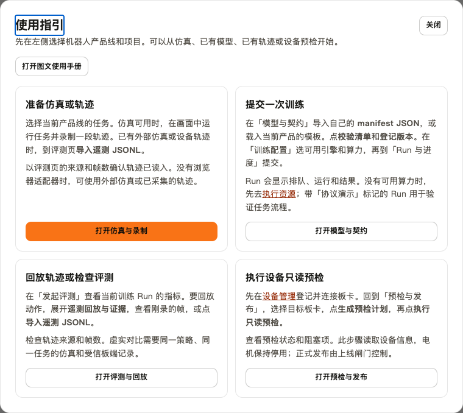
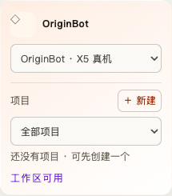
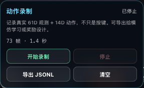
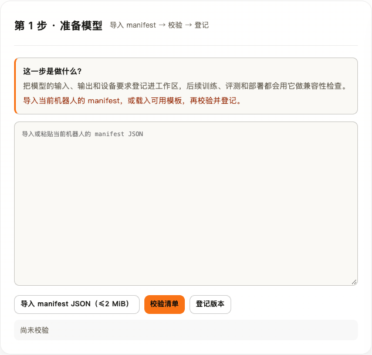
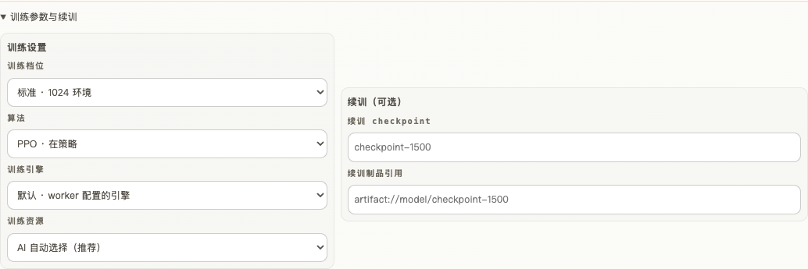
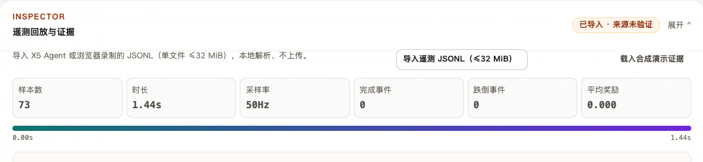
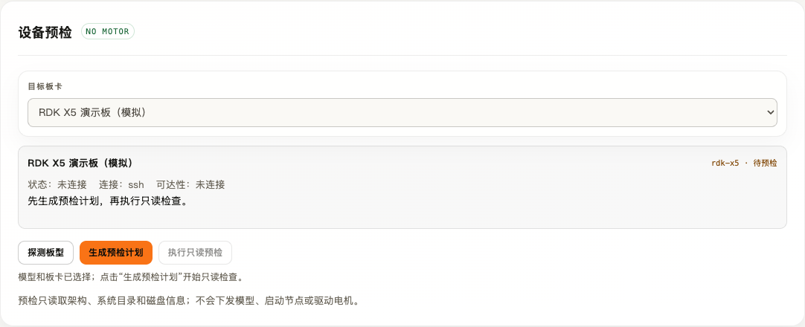

# RDK Robot Learning Platform 使用手册

在同一个工作台准备机器人任务和数据、训练或导入策略、检查评测，再对目标设备做只读预检。可以从任一已有输入开始，例如已有遥测就直接回放，已有模型就先导入契约。

打开工作台，点右上角的 **更多 → 使用指引 → 打开图文使用手册**。用「跳到章节」找步骤，用手册顶部的页面链接进入工作台。宽屏下手册保留在右侧，小屏下点页面链接会收起手册。重新打开可继续阅读。

已有人提供工作台地址时，用浏览器打开即可。自行试用时，在仓库根目录运行 `npm ci` 和 `npm run demo:sim2real`，打开终端打印的地址。演示环境提供模拟训练和模拟板卡，退出前请导出要保留的轨迹。浏览器仿真资源随产品线和平台配置而异。[首次启动与部署](first-run.md)

## 选对机器人、项目和任务

在左侧先选 **产品线**，再选 **项目**。产品线影响可用任务、参考模型与契约；项目用于查找属于同一实验的记录。找不到模型或 Run 时先核对这两项。切换产品线后，再确认当前项目和设备选择。

| 当前对象 | 从哪里开始 | 需要确认 |
| --- | --- | --- |
| MicroDuck 参考机器人 | **仿真与录制** | 仿真资源已挂载；可跟做下文的录制示例 |
| OriginBot 移动底盘 | 选 **OriginBot**，打开仿真任务或导入导航遥测 | 浏览器仿真需要连接对应后端；真机证据来自匹配的板端 Agent |
| RDK Duck | **模型与契约**，或导入外部仿真与设备轨迹 | 参考模板的观测和动作布局是否匹配实际模型 |
| OriginMan 人形机器人 | 选 **OriginMan**，进入模型与契约或看下方课程章节 | 按任务核对模型契约和算力 |
| 自有机器人或自定义适配器 | 选 **通用 RDK 设备**，导入机器人自己的 manifest | 产品标识、观测与动作、频率、模型制品与运行时是否匹配 |

没有浏览器适配器时，可以从外部仿真、设备遥测或已有模型开始。接入自己的本体时，先确认平台已具备对应的仿真、训练执行或板端能力，再选择所需的环节。[硬件适配](hardware-adapters.md)

## OriginMan 课程

选择 **OriginMan → 模型与契约**，在「登记模型」内选择 **受扰恢复 · SAC**，再点 **打开受扰恢复课堂**。在课堂里先看参考，选择算力和预算，确认后开始训练，随后查看同一策略的仿真评测与回放。

- [OriginMan 课程指引](../plugins/rdk-robot-learning-platform/references/user-guide.md#workshop受扰恢复课程)在工作台内打开八步交互指引，可按步查看训练、评测、回放和对照方法。
- [OriginMan 强化学习跳舞](../plugins/rdk-robot-learning-platform/references/user-guide.md#originman-强化学习跳舞)介绍舞段编排、算力和 PPO 训练。

## 准备数据或试跑仿真

- **有可用仿真**：打开 **数据与仿真 → 仿真与录制**，选当前产品的任务。使用场景内的控件进行录制。MicroDuck 参考场景使用键盘，OriginBot 导航场景使用目标点。
- **已有轨迹**：打开 **评测与证据 → 评测页面 → 遥测回放与证据**，用 **导入遥测 JSONL** 读入外部仿真或设备的记录。核对来源、帧数和采样率。
- **准备模仿学习数据**：按训练配置中的说明保存完整示教回合，使用与模型匹配的观测、动作和结束标记。短轨迹可以用于回放检查。

### 跟做示例：录制一段 MicroDuck 轨迹

1. 选择 **MicroDuck → 仿真与录制**。进入场景前确认仿真资源已就绪。
2. 点画面中的 **开始仿真**，再点左下角的 **开始录制**。用 `W/A/S/D` 移动几步，然后点 **停止**。
3. 在工作台页脚确认「已同步」和帧数。需要留存或转移轨迹时点 **导出 JSONL**，也可在评测页手动导入。

如果看到「资源待挂载」，按仿真页的安装指引挂载带录制面板的资源。没有资源时，可以直接用评测页的 **载入合成演示证据** 熟悉回放。[仿真资源挂载](demo-runbook.md#有上游-microduck-资源时)

## 登记模型并提交训练

1. 打开 **训练与策略 → 模型与契约**。已有模型时可使用工作区里的对应版本。新模型用 **导入 manifest JSON**；内置产品有匹配模板时可用 **载入模板**。核对产品标识、观测与动作布局、控制频率和制品引用。
2. 点 **校验清单 → 登记版本**。通用 RDK 设备页直接提供导入入口，下面是这一页的实际界面。

3. 打开 **训练配置**，选当前任务支持的引擎、档位和算力。有示教要求的引擎会显示数据条件。没有可用后端时，先到 **执行资源** 查连接。
4. 到 **Run 与进度**，确认所选模型并提交。打开同页的运行详情看排队、运行、日志和结果。带「协议演示」标记的 Run 用于验证流程；实际训练由所选 worker 执行。

执行资源接入及已有数据训练的要求见 [GPU Runner 接入](gpu-runner.md) 和[任务包训练](task-pack-training.md)。

## 回放轨迹与检查评测

打开 **评测与证据** 下的评测页面（「发起评测」或「评测结果」）。有训练 Run 时，查当前模型的关键指标；有轨迹时，展开 **遥测回放与证据**。先核对来源和帧数，再检查时间范围及动作、观测等诊断图。已有回放 Run 时，在「逐帧回放」选择该 Run，点「加载回放」后使用时间轴。指标显示「—」时，到 Run 详情确认 worker 是否回传了该指标。

做虚实对比时，进入 **结果对比**，使用同一策略、同一任务的仿真和受信板端记录。浏览器录制、合成演示和真机遥测有各自的来源标记。需要保存完整示教时，使用 **保存为独立示教 Run 并评测**。

## 连接目标设备并做只读预检

1. 在 **设备与发布 → 设备管理** 登记并连接目标设备，核对板型和硬件配置。
2. 打开 **预检与发布**，确认当前模型和 **目标板卡**。板型待探测时先点 **探测板型**。
3. 点 **生成预检计划 → 执行只读预检**。查看结果及阻塞原因，例如板端不可达或缺少匹配的制品。预检读取设备信息，电机保持停用。
4. 正式发布前，在 **运行反馈与回滚 → 上线闸门** 查看制品、评测和审批要求。下图用模拟板卡展示预检入口。

设备接入与板端诊断见[设备上位机](host-station.md)。需要找回历史模型、Run 或评测时，到 **证据与记录** 按项目、当前产品线和记录类型检查。
