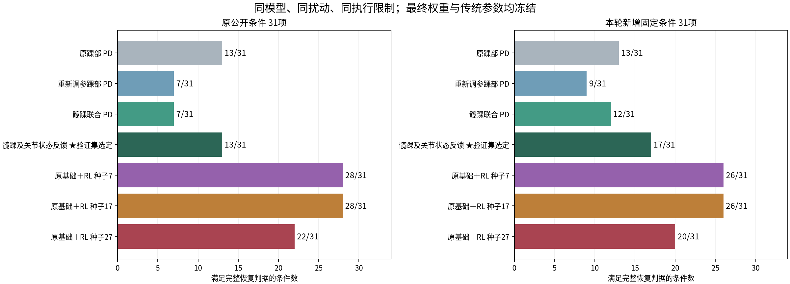
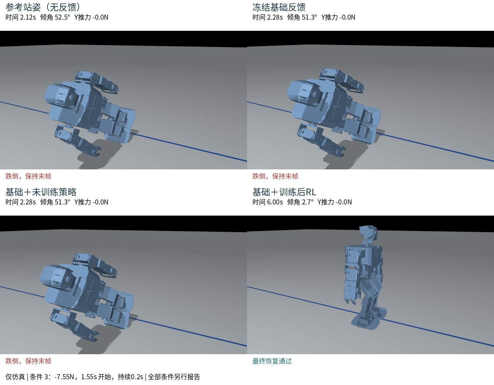
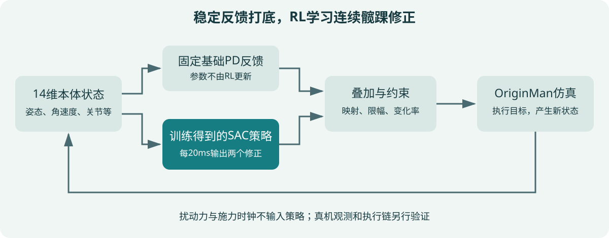
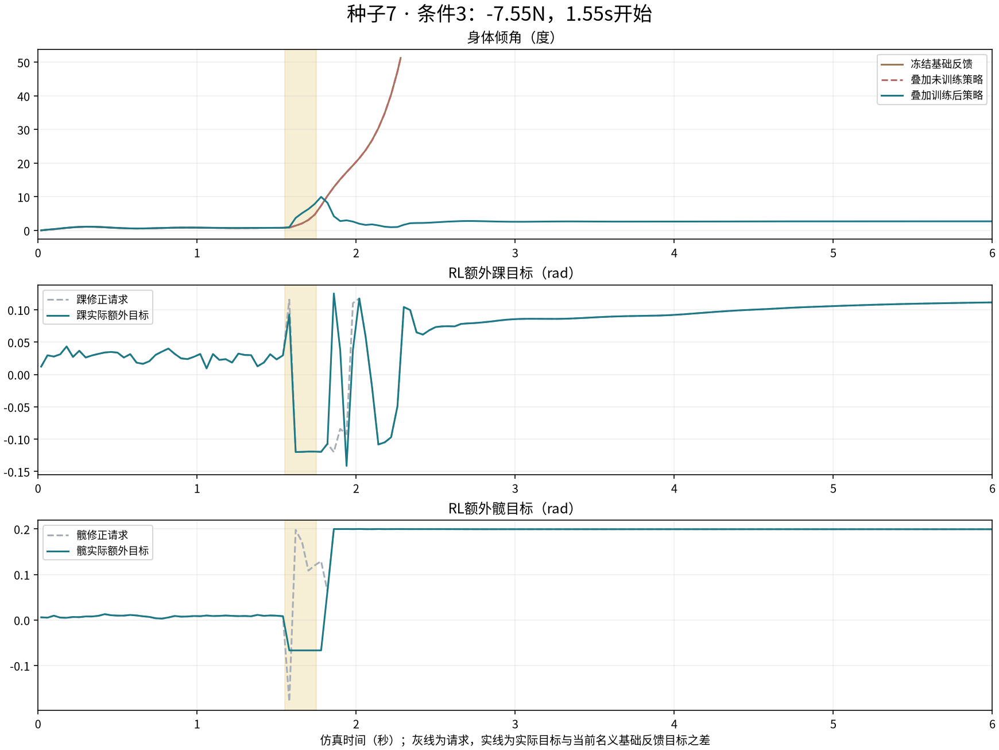
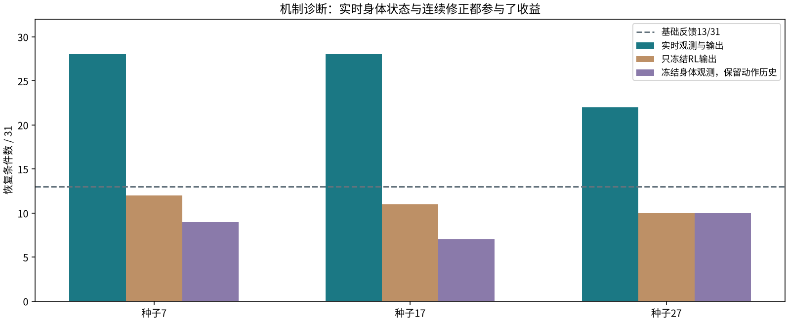
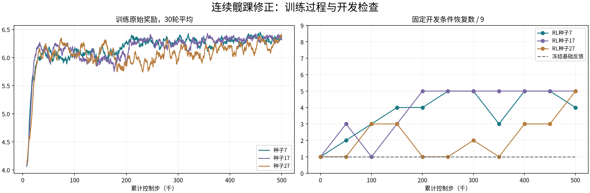
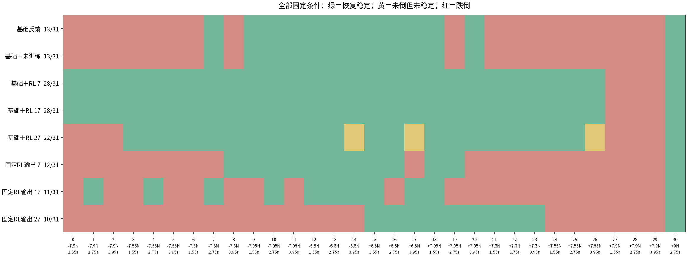

# OriginMan Workshop：让RL帮助机器人受推后恢复稳定

本版为4小时仿真课程的具体实施方案。主案例已经完成三个独立种子的仿真验证；
课堂入口和教材按这条已验证路线组织。整班彩排、学员电脑适配与真机迁移仍待完成。
课程选用稳定反馈＋连续髋踝强化学习，目标是让学员亲眼看到、亲自训练并解释
“同样扰动下，基础反馈失稳，加入RL后恢复稳定”。

当前交互主线使用 RDK Studio 自然语言调用平台插件。平台页面用于观察曲线、
物理回放和必要的人工操作；下面 CLI 仅供讲师离线复现，不要求学员在课堂切换终端。
软件迁移的本地验收与线上、Studio 安装后的验收分别记录，不能把本地通过称作上线完成。

## 课程主张的边界

已补充合理调参后的传统反馈对照，不再只拿原踝部 PD 作为唯一比较对象。

|控制器|原公开条件恢复数|新增固定条件恢复数|
|---|---|---|
|调参后选定的髋踝及关节反馈|13/31|17/31|
|原基础＋RL，种子7|28/31|26/31|
|原基础＋RL，种子17|28/31|26/31|
|原基础＋RL，种子27|22/31|20/31|

传统反馈经过1,141次参数评估后按独立验证条件冻结；RL权重未更换。新增条件中，
前两个种子净增9项，第三个仅净增3项，没有达到此前“净增至少6项”的明显收益门槛。
这只支持本轮反馈候选与确定性仿真范围内的比较，不证明RL优于所有传统控制方法。
全部失败、退化和条件见[传统反馈与RL完整对照](originman-feedback-benchmark.md)。



课堂先看明确标注的课前参考实验，再完成本组训练与真实对比；短训练没有改善也能
完成学习目标。趣味挑战只在主线结束后选做，不以“现场必须训练得更好”作为通关条件。

## 先看实际效果

同一OriginMan模型、同一初态，1.55秒开始施加−7.55N侧向力，持续0.2秒。
基础反馈在2.28秒触发跌倒判据；加入训练后的种子7策略，最大倾斜约10°，最终
约2.7°，通过恢复检查。视频中的失败画面保持实际终止姿态，不补演落地动作。



完整实验包含31个固定条件，使用最终权重，保留所有失败：

|控制方式|恢复条件数|跌倒条件数|相对基础反馈改善 / 退化|
|---|---|---|---|
|固定基础反馈|13/31|18/31|—|
|基础＋未训练RL|13/31|18/31|轨迹与目标指令完全一致|
|基础＋训练后RL，种子7|28/31|3/31|15 / 0|
|基础＋训练后RL，种子17|28/31|3/31|15 / 0|
|基础＋训练后RL，种子27|22/31|6/31|11 / 2|

三个策略有11个共同改善条件；种子27在正负6.8N、3.95秒开始的两个条件退化。
表中是有限确定性仿真覆盖数量，不是真机成功率。

## 本场课交付什么

学员完成一次从实验配置到评测报告的闭环，带走自己的配置、训练记录、初始与
最终权重、ONNX、逐条件结果，以及一页解释成功和失败原因的实验记录。
讲师提供经过验证的完整训练制品、三种子对照、训练阶段视频和失败案例。

|课程层次|本场安排|完成口径|
|---|---|---|
|必做主线|原地站立受扰，RL连续修正髋踝|同条件对照、真实训练、失败定位与记录|
|后续研发|把连续残差结构接入参考迈步|需要重新训练和验收，本场不称已完成步态RL|
|可选实物收尾|获得样机后独立演示官方人体跟随|不是RL恢复策略驱动的跟随，需独立联调和控制权切换|

此前三版本方案中保留的步态RL和最后人体跟随，继续作为后续集成目标。
本场先交付有证据的原地恢复课程。没有样机时，4小时仿真课可以完整进行；
不在末尾临时用动作组替代RL成果。

## RL到底负责什么

基础反馈始终固定：踝侧摆PD，Kp=2.5、Kd=0.225。SAC策略每20ms读取14维
本体状态，输出额外踝侧摆和髋侧摆两个连续目标，经映射影响左右四个关节。
参考站姿、PD和RL残差共同形成位置目标，再经过总幅度、变化率与执行器限制。



|环节|具体内容|课堂要解释的问题|
|---|---|---|
|观察|侧倾、俯仰、相应角速度，四个髋踝位置与速度，上次修正|机器人如何知道自己在失稳|
|动作|两个连续修正，经映射改变四个关节目标|何时用踝、何时配合髋部|
|奖励|保持姿态、降低角速度和平移速度、最终稳定；约束修正|为什么一直晃、只不倒或大幅乱动不够好|
|算法|SAC，通过物理交互学习神经策略|没有成功动作标签，如何通过试错学到修正|
|约束|请求幅度0.12/0.20rad，总残差与变化率限制|请求并不总能完整下发，指令也不是实测角度|

策略不读取扰动力、施力方向、施力时刻或世界XY位置。世界速度可用于仿真奖励
和评测，但不作为策略的部署输入。所有动作幅度、20ms周期、伺服增益和力矩上限
都是当前仿真假设，不能直接当作真机允许值。

冻结RL输出后，三个种子只恢复12、11、10个条件；冻结身体观测、保留上一步
动作输入后只恢复9、7、10个条件。这支持本轮收益依赖实时身体状态与连续修正。
目前证明的是超过这组固定PD，不能宣称RL优于所有传统髋踝控制方法。





## 四小时怎么上

以下是课程编排目标，尚未经整班实测。每组建议2人，一人操作，一人记录对照。
学员需能运行基础Python命令、编辑JSON；不要求提前掌握SAC推导。

|时间|环节|学员操作|可检查产物|
|---|---|---|---|
|00:00–00:20|先看效果|播放同扰动四组对照，再看一个RL失败条件|写出RL改善了什么、没有覆盖什么|
|00:20–00:45|模型与状态|认识自由底座、脚底接触、髋踝方向；查看观测编码|能对应14维状态和两个输出|
|00:45–01:10|固定反馈基线|查看基础与未训练策略逐帧一致的证据，辨认失稳条件|记录基线13/31和一个失败条件|
|01:10–01:30|设计学习任务|解释奖励、动作限制与恢复判据|每组写出一个可检验假设|
|01:30–01:40|休息|—|—|
|01:40–02:25|新建并训练|创建独立目录，从零修正训练；看曲线和开发检查|实验配置、日志、权重及训练状态|
|02:25–03:00|固定条件评测|比较基础、未训练、训练后和冻结输出|31条件报告、改善和退化编号|
|03:00–03:25|只改一个变量|改训练侧推上限或随机种子，新建第二组实验|明确修改项与原因，时间不足保留已运行部分|
|03:25–03:45|定位与讲解|结合倾角、修正目标和失败记录讲解结果|每组一页实验记录|
|03:45–04:00|复盘与迁移边界|说明真机需要补哪些数据；介绍下一步步态任务|能区分仿真收益、后续研发和硬件验证|

现场主实验采用与完整验证一致的500,000步请求预算；训练器实际完成500,224步。
若课前计时无法在环节内完成，可缩短至100,000步，但不能承诺达到完整策略的收益。
讲师在本次记录所用主机上，种子7完整500,224步耗时约757秒；这是单次记录，
不是学员电脑或整班并发的时长承诺。开课前逐台计时，决定现场跑10万还是50万步。
现场训练超过环节时间时，保留日志和真实状态，转用明确标注的课前权重完成评测。



## 学员实际执行的步骤

优先在 Studio 对话中沿同一账号、同一插件连接操作。工具返回的入口、完成状态、
策略加载、物理成功分别核对。课前必须在最终安装版本实跑以下操作卡；当前插件
缺少 OriginMan 工具时保持未就绪，不切换匿名连接或套用 MicroDuck。

|环节|自然语言操作卡|应看到的证据|
|---|---|---|
|准备|“帮我准备 OriginMan 受扰恢复体验，先检查当前账号与平台，暂不训练。”|`rdk_experience_prepare` 的明确机器人入口；打开后显示 OriginMan，不是机器鸭|
|契约与资源|“读取 OriginMan 课程目录，核对14维观测、2维修正；查看本次可用执行资源，先不提交。”|`rdk_workshop_catalog`、模型契约和资源检查回执；预检不代替训练|
|登记|“使用刚才目录返回的 manifest 登记本组模型；已有同版本时复用明确的模型ID。”|`rdk_model_register` 或已有模型ID；占位 manifest 不是已训练权重|
|训练|“按核对过的模板提交一次本组训练，保留幂等键和Run ID；等待时只查状态和日志。”|`rdk_training_submit`，engine=originman-recovery、algorithm=sac、numEnvs=4，以及冻结的训练配置|
|评测|“评测刚才完成的训练Run，使用同一模型、资源和冻结配置，创建一条评测Run。”|phase=evaluate、sourceRunId；平台解析父权重来源，不接受用户提供服务器文件路径|
|解释|“查看本组训练和评测Run的流程检查，解释改善、退化与未达标条件，不把参考成绩当作本组结果。”|`rdk_workflow_inspect`：productId=originman、runId、evaluationRunId；策略摘要和父Run匹配|
|回放与导出|“打开本次评测记录，让我查看物理回放并保存本组报告。”|本次视频与下载文件；必要时在平台点击，不声称对话已替用户点击|

模板的主实验预算是500,000步；课前计时不足时可选择明确标为软件体验的短训练。
4096步本地验收已出现基础13/31、训练后13/31的结果，这说明链路执行成功，
不能说明策略学好了。当前没有样机，站立、行走、视觉跟随及真机部署不作为通关步骤。

工作台“训练与策略 → OriginMan Workshop”可作必要的人工入口。启动和运行记录见
[工作台纯仿真流程](originman-workbench.md)。以下CLI保留为讲师准备、排障与离线复现入口。

依赖和模型由讲师提前准备。以下命令在仓库根目录运行，使用同一Python环境。
模型目录是调用方提供的适配场景及其meshes资源；不把厂家原始资产打包到公共仓库。
页面已接入现有工作台，底层CLI仍可独立使用；板端部署尚未完成。

### 1. 课前安装并检查

```bash
uv venv --python 3.12 .eval-venv
uv pip install --python .eval-venv/bin/python -r engines/originman-straight/requirements-sb3.txt
.eval-venv/bin/python engines/originman-straight/workshop.py --help
```

CPU可运行；本例不以GPU、开发板或样机作为仿真开课前提。讲师必须提前验证所用
操作系统的物理渲染、依赖安装与本地浏览器播放。安装遇到问题，优先使用已验证
的讲师环境，不在课堂临时更换物理参数“修好”结果。

### 2. 创建不可覆盖的实验

```bash
.eval-venv/bin/python engines/originman-straight/workshop.py prepare \
  --scene artifacts/originman-straight/push-model-01/scene.xml \
  --workspace artifacts/originman-classroom/group01-a \
  --steps 500000 --seed 7 --push-max-force 8.1
```

该模型路径是本次研发工作区的示例，其他机器由讲师替换为实际模型路径。
prepare固定本组配置与31条件课堂基准，记录摘要；已有目录会拒绝覆盖。
基准复用已公开实验条件，因此课堂反复修改后得到的结果不能再称“未见测试”。

### 3. 训练并观察

```bash
.eval-venv/bin/python engines/originman-straight/workshop.py train \
  --workspace artifacts/originman-classroom/group01-a
```

另开终端启动只读观察页，端口使用系统分配值：

```bash
.eval-venv/bin/python engines/originman-straight/standing_live.py \
  --root artifacts/originman-classroom/group01-a --port 0
```

打开终端打印的网址，选择standing-residual-seed7。检查累计步数、状态、奖励和
每5万步开发检查。初始阶段策略的确定性均值为零；探索采样仍会产生试探动作。
奖励上升只表示优化信号变化，最终效果要看下一步固定条件评测。

### 4. 评测，生成本组图文结果

```bash
.eval-venv/bin/python engines/originman-straight/workshop.py evaluate \
  --workspace artifacts/originman-classroom/group01-a
.eval-venv/bin/python -m http.server 0 --bind 127.0.0.1 \
  --directory artifacts/originman-classroom/group01-a/report
```

evaluate调用现有五组物理对照并生成统计与图文页。报告显示改善、退化及所有条件，
未达到判据时会明确显示未通过。它不会把讲师权重结果填进学员结果。
完整逐控制步输入输出、关节目标和物理轨迹在evaluation/episodes.jsonl中。
完整三种子的视频与冻结观测诊断由讲师材料提供，不要求学员当场重新跑完。

### 5. 改一个变量，保留旧实验

```bash
.eval-venv/bin/python engines/originman-straight/workshop.py prepare \
  --scene artifacts/originman-straight/push-model-01/scene.xml \
  --workspace artifacts/originman-classroom/group01-b \
  --steps 500000 --seed 7 --push-max-force 7.5
.eval-venv/bin/python engines/originman-straight/workshop.py train \
  --workspace artifacts/originman-classroom/group01-b
.eval-venv/bin/python engines/originman-straight/workshop.py evaluate \
  --workspace artifacts/originman-classroom/group01-b
```

固定种子和50万步预算，只把训练侧推上限8.1N改为7.5N，评测仍用相同31个条件。
问题是“训练范围变窄后，强推条件是否更差”，不预先规定答案。也可只换种子，
观察学习结果是否稳定。当前课堂入口不提供任意奖励编辑；进阶修改需改
residual_env.py并新建实验、重新验证输入与制品约定。

## 什么叫通过

### 动作恢复判据

每个回合6秒、不触发跌倒，并在最后1秒至少90%的控制步同时满足：
倾角≤5°，角速度≤0.3rad/s，平面速度≤0.05m/s，高度≥初始85%，
平面位移≤12cm，且双脚接触。只不倒、持续晃动或离开任务范围均不计恢复。
这里“原地”允许小范围位移，不要求脚底完全锁死或回到原始坐标。

### RL明显收益判据

固定31个条件，相对基础反馈净增加至少6个恢复条件，无扰动站立通过，且至少
3个条件中实时策略恢复而冻结RL输出未恢复。原三种子完整训练均达到该判据。
课堂短训练不自动享有这个结论，必须按本组真实结果判断。



### 学员完成与课程开课是两种验收

学员完成是能复现对照、运行真实训练、正确解释本组结果并提交记录；自己的短训练
未达明显收益也可以完成实验分析。课程采用的主示例则必须保持已验证的明显收益，
并清楚标注所用课前权重。整班开课还要经过同版本、同设备配置的完整彩排。

## 课堂兜底怎么做

|情况|现场处理|必须向学员说明|
|---|---|---|
|训练慢或环节到时|保留当时日志，切换讲师完整权重完成同条件评测|该效果来自课前训练，本组短训练单列|
|本组训练无收益或退化|如实生成报告，与完整训练曲线和失败条件比较|不是所有随机种子或训练预算都会学好|
|渲染打不开|用提前验证的视频和数值结果继续讲解；CPU训练、评测可独立进行|视频是指定实验回放，不是当前实时画面|
|网络不可用|使用课前准备的依赖环境、模型和本地材料|不依赖临时联网下载才能完成主线|
|模型或依赖版本不一致|回到课前验证环境，保留异常记录|不通过换测试条件或篡改物理模型制造改善|
|没有样机|完整完成仿真主线，展示迁移清单|本场没有完成真机RL与人体跟随联调|

## 已有、我们补开发、厂家提供、真机验证

|分类|本方案具体内容|当前状态|
|---|---|---|
|已有并复用|原始URDF/STL、自由底座仿真、SAC训练、日志快照、ONNX校验、回放基础|已用于本次实验；原始模型由调用方提供|
|本轮已完成|稳定PD＋连续髋踝RL、三种子对照、冻结输出/观测诊断、物理假设检查、视频和图文报告|原地仿真有明显收益|
|本次课堂补开发|独立实验准备/训练/评测入口、学员图文页、固定课堂基准、讲师方案与操作手册|已形成，验收记录见交付说明|
|仍由我们补齐|按组打包与分发、讲师机到学员机适配、完整彩排、后续迈步训练与其工作台集成|尚未完成，不计入当前平台全流程能力|
|厂家确认模型|拟用整机的机械、相机、电池与模型版本对应|用于核对质量、重心、脚底和装配|
|厂家确认接口|四个髋踝关节的ID、方向、零位、限位及位置回读单位；目标覆盖/排队和插值语义|用于把修正准确转为连续位置目标|
|厂家确认传感|IMU轴向、单位、配置与姿态接口；实际SDK、镜像、固件和执行器型号|用于形成真实14维观测与正确执行链|
|真机测量|关节响应、回差、速度估计、IMU延迟、读写周期、数据年龄、供电与接触|无样机，尚未实测|
|真机验收|保护条件下基础站立、同条件基础/RL对照、退出恢复；之后独立人体跟随|尚未完成；不直接采用仿真幅度与侧推牛顿数|

不要求厂家重新提供已公开的编号图，也不要求厂家代做训练。没有现成时序或负载
响应报告时，由我们拿样机后测量补齐。完整项目清单见
[厂家确认与真机验证](originman-confirmation-and-hardware.md)。

## 讲师课前与课后交付

课前固定一份模型摘要、代码快照、Python依赖、控制器约定、初始/最终权重、
31条件基准、完整三种子报告及失败回放。核对策略是14维输入、2维修正，
不能交给旧的41维输入、10维动作适配器运行。

用计划使用的电脑完整走一遍prepare→train→evaluate→report，记录耗时、退出码、
渲染与浏览器播放结果；以实际训练吞吐决定课堂预算。由另一名操作者按教材复现，
再完成计划组数的并发彩排。仿真动作已验证不等于整场课程已验收。

学员记录至少回答四项：本组只改了什么；恢复、改善和退化各多少；选一个条件
用身体倾角与目标修正解释结果；还缺哪些真机证据。每组提交独立实验目录，
不覆盖旧权重，不删除失败，也不将课堂公开基准包装成未见测试。
可直接填写仓库中的engines/originman-straight/workshop/experiment-record.md模板。

研发细节见[连续髋踝RL验证](originman-continuous-residual.md)，较早阶段与三个
课程版本见[项目总方案](workshop-originman-x5.md)。

## 本次交付核验

课堂入口已实际完成一次8,192步的从零训练及31条件评测，完成832次梯度更新、
ONNX导出与制品校验，并生成本组报告。这次短训练只恢复5/31，低于基础反馈的
13/31；报告如实标为未达标，并保留8个退化条件。它用于验证课堂链路和失败处理，
不作为课程的效果权重。课程效果依据仍是完整500,224步的三个独立实验。

新增检查覆盖实验目录防覆盖、配置改动后拒绝沿用、无效训练范围，以及未达标
结果展示和错误收益声明拒绝。三项检查通过。完整原地控制实验此前54项软件检查
通过；本次没有重新进行真机、整班并发或学员电脑验收。

工作台接入后已重新从页面完成50万步请求训练、独立31条件评测和物理回放。
本次实际500,224步，基础反馈13/31，RL28/31，无扰动站立保留，达到明显收益
判据；服务重启后记录恢复。本次还保留短训练未达标的页面结果，不混用两份权重。
